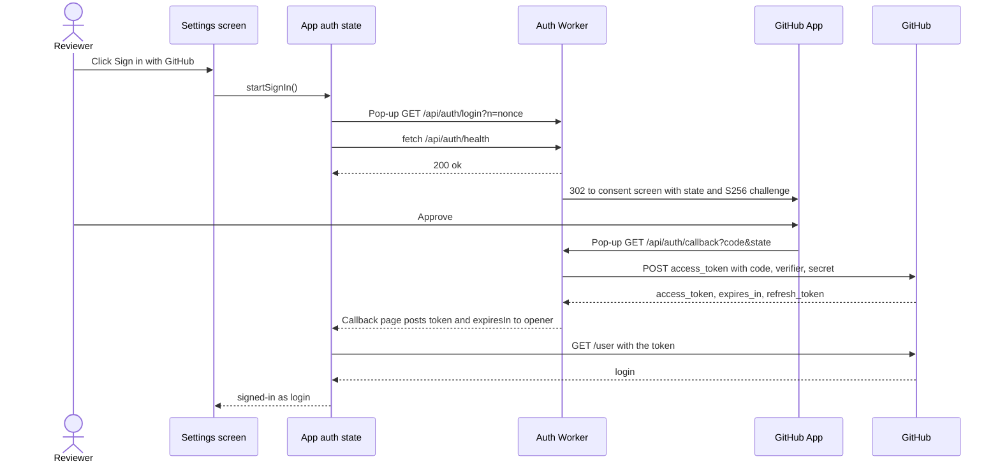
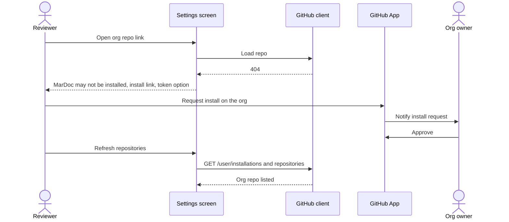
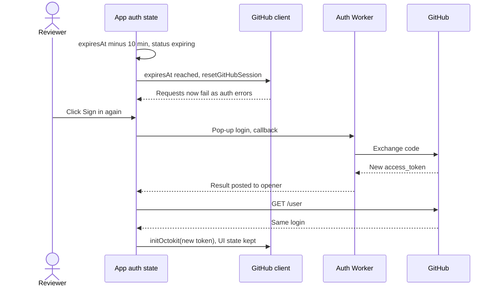
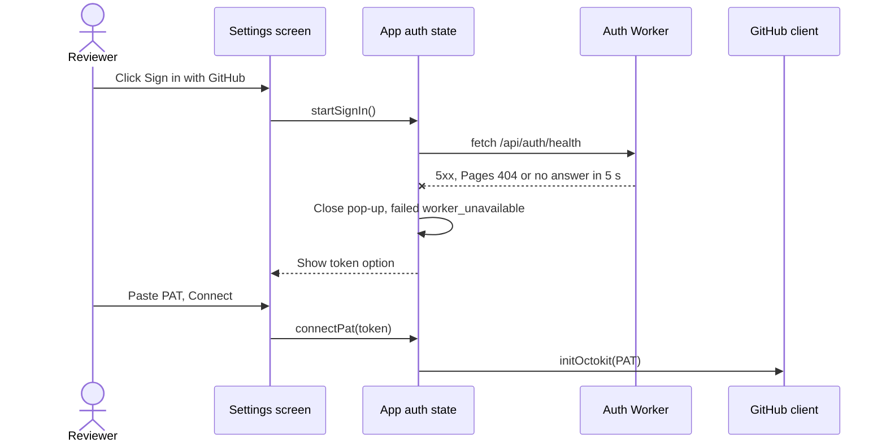

# GitHub sign-in: design

Level: L2 (technical record for the L1 [architecture page](architecture.html))

> Stage 1 of GitHub sign-in adds a **Sign in with GitHub** button that opens
> a small pop-up. The pop-up goes through a stateless Cloudflare Worker on
> `mardoc.app/api/auth/*` and the GitHub App's consent screen. The Worker
> hands an 8-hour access token back to the MarDoc tab that opened it, and the
> tab keeps the token in memory only. The tab never reloads, so the user
> stays where they were. When the token expires or the tab reloads, the user
> signs in again. A personal access token still works beside it.
>
> Start with [how the system works](architecture.html). This record follows
> the same order: why it matters, the problem domain, the parts, then
> sequences and special concerns, and their proof. It answers
> [requirements.md](requirements.md) and builds on the accepted as-is
> baseline of the [GitHub connection](../github-connection/architecture.html)
> (R-2).

## Value and scope

**Who benefits and how:** new reviewers connect without making a token
(S-10, S-12). Every user gets an access token limited to the repositories
where MarDoc is installed, and it expires after 8 hours (S-13,
[GitHub docs](https://docs.github.com/en/apps/creating-github-apps/authenticating-with-a-github-app/refreshing-user-access-tokens)).

**Current pain and evidence:** connecting needs a pasted PAT
(`SettingsPanel.tsx:97-110` at `2b79817`), which stays in
`localStorage.mardoc_github_token` (`app-context.tsx:91, 286-318`), where a
rendered document's script can read it (SEC-01, RK-1). Issue #146 states the
need; there is no measurement of how many users stop at the PAT step
([L0 § Why](strategy.html#why)).

**Success signals:** a user with MarDoc installed is signed in with at most
2 clicks (F-11); the stage 1 gate finds no token in storage (F-30); every
existing PAT spec passes unchanged (F-50).

**In scope:** stage 1. That means Settings sign-in, the Worker's `health`,
`login`, `callback` and `revoke` routes, the in-memory session and its
expiry, the install link and messages, the PAT fallback and the
documentation changes (F-70 to F-72).

**Out of scope:** stage 2 silent refresh ([requirements § Stage 2 note](requirements.md#stage-2-note));
VS Code extension sign-in; the SEC-01 fix; moving hosting.

## Problem domain

### Context

A **reviewer** holds a GitHub account. The **MarDoc GitHub App** is
registered by MarDoc's owner, and users or org owners install it on chosen
repositories; an **installation** decides which repositories the App can
reach. A **user access token** that GitHub issues for the App can reach a
repository only when the reviewer can reach it *and* an installation covers
it, and it expires after 8 hours. GitHub issues that token only to a
server that presents the App's **client secret**. Its token endpoint sends
no CORS headers ([community #15752](https://github.com/orgs/community/discussions/15752)),
so MarDoc's static page cannot complete the exchange itself.

The tab that will hold the token also renders repository HTML on the same
origin (SEC-01), so whatever the tab holds, a document script can reach.


Editable source: [domain.drawio](diagrams/domain.drawio).

What makes this hard: the token must cross from a server-side step into one
browser tab without touching storage or a URL. That tab must be sure the
token answers the sign-in it started. The tab must cope with the token dying
after 8 hours (NF-12), or on reload, without losing the reviewer's place.

### Language and model

| Term | Meaning in this design |
|---|---|
| Credential | The one GitHub token a tab uses: a **PAT** (pasted), an **embed token** (from VS Code) or a **sign-in token** (from Sign in with GitHub). |
| Sign-in token | A GitHub App user access token, held in memory, with an expiry time. |
| Sign-in attempt | One click of Sign in with GitHub: a pop-up, a one-time value (the **attempt nonce**) and a deadline. |
| Sign-in result | The message the callback page posts back: the token and its lifetime, or an error code. |
| Session status | Where the tab's sign-in stands: `signed-out`, `signing-in`, `signed-in`, `expiring`, `expired`, `sign-in-again` (after reload) or `failed`. |
| Installation | GitHub's record that the App may reach an account's chosen repositories. |
| Sign-in marker | `localStorage.mardoc_auth_method = "github-app"`: a non-secret hint that this browser used sign-in last (Q-20). |

### Rules that must hold

| ID | Domain rule / invariant | Requirements | Preserved by | Checked by |
|---|---|---|---|---|
| I-10 | A sign-in token is never written to web storage, a cookie the page can read, or a URL. | F-30, NF-11 | Session holds it in a closure; callback page posts it, never redirects with it | T-10, T-11 |
| I-11 | The tab accepts a sign-in result only when its origin is the app origin, its source is the attempt's pop-up, and its nonce equals the attempt nonce. | F-14 | Sign-in window adapter | T-12 |
| I-12 | The Worker contacts GitHub's token endpoint only after the callback's `state` equals the login cookie's. | F-20 | Worker callback domain check | T-20 |
| I-13 | A refresh token never leaves the Worker's exchange step. | F-24, C-16 | Result shaping drops it | T-21 |
| I-14 | A tab has at most one credential. | F-53 | Session replaces the credential; Settings removes a saved PAT on sign-in | T-13 |
| I-15 | The tab sends no GitHub request with a sign-in token at or after its expiry time. | F-33, NF-12 | Session expiry check before each request | T-14 |
| I-16 | The Worker never logs a token, code, verifier or secret. | NF-15 | No logging in the Worker | T-22 |

## Solution at a glance

The click that starts sign-in opens a **pop-up** at `/api/auth/login`. The
Worker sets short-lived `state`, PKCE and nonce cookies and redirects to
GitHub's consent screen. GitHub redirects back to `/api/auth/callback`,
where the Worker checks `state` and exchanges the code with the client
secret. It drops the refresh token and returns a tiny page that posts the
access token to `window.opener`, targeted at `https://mardoc.app`, then
closes. The MarDoc tab never navigates, so its route, open document and
unsaved edits stay put (S-15, S-16). GitHub's sign-in pages send no
`Cross-Origin-Opener-Policy` header (curl of `github.com/login` and
`/login/oauth/authorize`, 2026-10-21), so the opener should survive. SP-3
confirms it per browser (A-10).

The tab's **auth state** treats the sign-in token as a third kind of
credential beside the PAT and the embed token. It holds the token only in
memory, tracks its expiry, and moves the UI to Sign in again on expiry, on a
401 or after a reload. Signing in again as the same GitHub login replaces
the token without the reset that connecting does today
(`app-context.tsx:286-307`).

Trade-offs: a pop-up keeps the page alive but can be blocked, so Settings
opens it only from a click, and explains a blocked pop-up. Memory-only
tokens mean a reload costs one more click, the price of S-25 until stage 2.
The direction and its alternatives are in
[ADR 0001](../../adr/0001-web-sign-in-github-app-worker-route.md).

**Deployment assumption (C-10, C-12, ADR 0001):** the app runs in the
reviewer's browser, served by GitHub Pages. The Auth Worker runs on
Cloudflare's edge for `mardoc.app/api/auth/*` only. GitHub (github.com and
api.github.com) is external. No other server exists; documents never pass
through the Worker. If the route ever fails, the fallback host is
`auth.mardoc.app` (L0 proof 1), which would add cross-origin set-up to the
hand-off.

**Implementation snapshot:** `2b79817df4eb4929da6809f215ed4cb3750a37da`.
`src/` is unchanged since `2b94d90` (`git diff --stat 2b94d90 2b79817 -- src`
is empty), so the R-2 baseline describes it.

### Assumptions affecting the design

| Assumption in `requirements.md` | Design areas that change if it is wrong |
|---|---|
| A-10 | Sign-in window adapter and callback page switch to `BroadcastChannel("mardoc-sign-in")`; T-12 changes. |
| A-12 | No sign-in marker; the reload journey shows the signed-out Settings view. |
| A-13 | Session allows a saved PAT beside a sign-in token; I-14 is narrowed. |
| A-16 | `fetchUserRepos` keeps `GET /user/repos`. |
| A-19 | RK-3 stays open in stage 1; T-15 is dropped from the gate. |

## Components


Editable source: [components.drawio](diagrams/components.drawio). Dashed
boxes are proposed; the others exist at the snapshot.

| Component | Responsibility | Owns | Interfaces / collaborators | Requirements |
|---|---|---|---|---|
| Settings screen | Offers sign-in and the PAT, shows who is signed in, links installs | Its view state | Calls auth state; links GitHub install page | F-10, F-13, F-41, F-50, F-53, F-71, F-72 |
| App auth state | Holds the one credential, its expiry and session status | Credential, session status, attempt | Pop-up and `message`; `/api/auth/health`, `/revoke`; GitHub client | F-12, F-14, F-30 to F-36, F-51, F-52, F-60, F-61 |
| GitHub client (recap) | Sends GitHub requests with the current token | Octokit instance, caches | `initOctokit`, `resetGitHubSession` | F-40, F-60 |
| localStorage (recap) | Keeps the PAT and non-secret keys | `mardoc_github_token`, `mardoc_auth_method` | `safeStorage` | F-50, F-32 |
| Rendered HTML iframes (recap) | Show repository HTML on the app origin | Document scripts | Same-origin access to the tab (SEC-01) | RK-1 |
| Auth Worker | Exchanges the code for a token; revokes tokens | Nothing durable; 10-minute cookies | `/api/auth/*`; GitHub OAuth and API | F-20 to F-27, F-61 |
| GitHub Pages (recap) | Serves the static app | The `out/` build | HTTPS for every non-`/api/auth/*` path | C-10 |
| GitHub App | Defines what MarDoc may reach | Client ID, secret, permissions, installations | Consent screen, install page | C-11, NF-10, F-40 to F-43 |
| GitHub (recap) | Issues tokens and serves repositories | Accounts, repos, grants | `login/oauth/*`, REST and GraphQL | F-11, F-40 |

### Settings screen

**Responsibility:** the GitHub Connection tab of `SettingsPanel.tsx`. It
offers **Sign in with GitHub** first and the PAT behind "Use a personal
access token" (F-10). Signed in, it shows "Signed in with GitHub as
`<login>`", Disconnect and "Install MarDoc on more repositories" (F-13,
F-41). It shows failures with the PAT option and the guide link (F-51,
F-52, F-71).

**Owns:** whether the PAT form is open; nothing persistent.

**Interfaces and collaborators:** calls `startSignIn()` synchronously from
the button's click handler, because the pop-up must open inside the click to
pass pop-up blockers. Reads `session` from auth state. Calls `connectPat(token)`
(today's `setGithubToken(token)`) and `disconnect()`. When a PAT is saved,
the sign-in button reads "Sign in with GitHub (replaces your saved token)",
and the click is the confirmation (F-53). The help text replaces "there is
no server" with the data-and-security.md wording (F-72, Q-10).

**Does not do:** hold the token, open the pop-up itself or talk to the
Worker; auth state does. It is hidden in embed mode (F-15).

**Failure behavior:** every failure arrives as a session status with an
error code; the screen maps codes to text (table in
[Sign-in result codes](#sign-in-result-codes)) and always offers the PAT.

### App auth state

**Responsibility:** the credential part of `AppProvider`
(`app-context.tsx:144-146, 286-331` today), extended with a pure
**session model** (`src/lib/auth/session.ts`) and a browser **sign-in window
adapter** (`src/lib/auth/sign-in-window.ts`). It runs the attempt, accepts
the result (I-11), keeps the token in memory (I-10), watches expiry (I-15),
and decides between "same login: keep everything" and "new login: reset"
(F-35, F-36).

**Owns:** `credential: {kind: "pat" | "embed" | "sign-in", token, login?, expiresAt?} | null`;
`session` status; the current attempt (pop-up handle, nonce, deadline).

**Interfaces and collaborators:**
- **Out to the pop-up:** `window.open("/api/auth/login?n=<nonce>", "mardoc-sign-in", "popup,width=600,height=720")`.
- **In from the pop-up:** `message` events of the [sign-in result](#sign-in-result-message) shape.
- **To the Worker:** `GET /api/auth/health` (5 s† timeout, F-51) and `POST /api/auth/revoke` on Disconnect (F-61).
- **To the GitHub client:** `initOctokit(token)` on sign-in and sign-in again; `resetGitHubSession()` on expiry and Disconnect.
- **To GitHub, through the client:** `GET /user` once after each result, to learn the login (F-13, F-35).
- **To localStorage:** only the sign-in marker (Q-20) and, on sign-in, removal of `mardoc_github_token` (F-53).

**Does not do:** store the token; render UI (Settings and the banner do);
check repository access (GitHub does).

**Failure behavior:** a blocked pop-up, a failed health check, a closed
pop-up, a timeout or an error result each end the attempt with
`session = failed(code)`; the existing credential, if any, is untouched.
On expiry or a 401 the status becomes `expired`. The tab keeps its route and
state, and requests fail fast with an auth error until the user signs in
again.

### GitHub client (recap)

Owned by the [GitHub connection baseline](../github-connection/architecture.html#parts).
Stage 1 adds one `before` request hook: when the credential is a sign-in
token past `expiresAt`, it throws an auth error without sending (I-15). For
a sign-in token, `fetchUserRepos` lists `GET /user/installations` and then
`GET /user/installations/{id}/repositories` (A-16, F-40). `formatApiError`
says "Sign in again" instead of "Open Settings to re-authenticate" when the
credential is a sign-in token (F-34).

### localStorage (recap)

Owned by the baseline. Stage 1 adds one non-secret key, `mardoc_auth_method`
(Q-20), and writes no token for sign-in (I-10).

### Rendered HTML iframes (recap)

Owned by the baseline; SEC-01 owns the fix. A document script runs as
`mardoc.app`. It can read the in-memory token through the parent window, and
it can listen for `message` events on the parent. Stage 1 limits that
exposure to an 8-hour token covering installed repos; it does not remove it
(RK-1).

### Auth Worker

**Responsibility:** the only server-side step. `login` starts an attempt;
`callback` checks `state`, exchanges the code with the client secret and
PKCE verifier, and hands the access token to the opener. `revoke` deletes a
token at GitHub; `health` says it is routed (F-20 to F-27, F-61).

**Owns:** no durable state (F-26). Three cookies per attempt,
`__Secure-mardoc_auth_state`, `__Secure-mardoc_auth_verifier` and
`__Secure-mardoc_auth_nonce`: `HttpOnly; Secure; SameSite=Lax;
Path=/api/auth; Max-Age=600`, cleared at the callback. Config: `CLIENT_ID`
and `APP_ORIGIN` vars, `CLIENT_SECRET` secret (C-13).

**Interfaces and collaborators:** the routes in
[Worker routes](#worker-routes). Out to GitHub:
`POST https://github.com/login/oauth/access_token` (form-encoded, as SP-1
found) and `DELETE https://api.github.com/applications/{client_id}/token`
(basic auth). No CORS headers on any response (F-22). Every response has
`Cache-Control: no-store` (NF-14).

**Does not do:** store or return refresh tokens (I-13); call GitHub on
the user's behalf beyond the exchange and revoke; see documents; log
(I-16); serve any `/refresh` path (F-25).

**Failure behavior:** a GitHub error becomes a result with only the error
code. A network failure or 5xx from GitHub becomes `exchange_failed`. A
missing or mismatched cookie becomes `state_mismatch`. If the Worker itself
is down or unrouted, the pop-up shows a Cloudflare error or a Pages 404, and
the tab's health check catches it first (F-51).

### GitHub Pages (recap)

Serves every other path, unchanged (C-10). SP-1 criterion 2 proved it with
the route in place.

### GitHub App

**Responsibility:** GitHub's record of what MarDoc may do. It defines the
permissions (NF-10) and the callback URL, and it makes user tokens expire.
Its installations define which repositories a sign-in token reaches (F-40,
S-13).

**Owns:** client ID; client secret (copied once into Worker secrets); the
permission set (Contents read and write, Pull requests read and write,
Metadata read, Q-19); callback `https://mardoc.app/api/auth/callback`;
"Expire user authorization tokens" on; "Request user authorization (OAuth)
during installation" on; installations.

**Interfaces and collaborators:** the consent screen at
`/login/oauth/authorize`; the install page
`https://github.com/apps/<slug>/installations/new` (F-41). On that page an
org member who is not an owner can only request an install. GitHub then
notifies the org owners, who approve or decline (SP-1 criterion 5).

**Does not do:** run code; MarDoc does not use installation tokens or
webhooks in stage 1.

**Failure behavior:** a revoked or suspended App makes every sign-in token
fail with 401, so users see Sign in again and then a sign-in error, and the
PAT keeps working. A leaked secret is rotated by the runbook (NF-21, SP-2).
Only the owner registers or changes it (C-14).

### GitHub (recap)

Owned by GitHub. It issues the code and token, returns `expires_in: 28800`
for expiring user tokens, and answers 404 for a repository outside the
installation, as SP-1 criterion 4 showed.

## Interfaces and data

### Worker routes

All routes are `https://mardoc.app/api/auth/*`, with `Cache-Control:
no-store`, `Referrer-Policy: no-referrer`, `X-Content-Type-Options: nosniff`,
and no `Access-Control-*` headers.

| Route | Request | Response | Errors |
|---|---|---|---|
| `GET /health` | none | `200 {"ok":true,"version":"<git sha>"}` | none; absence is the signal |
| `GET /login?n=<nonce>` | `n`: base64url, 22 to 64 chars | `302` to `https://github.com/login/oauth/authorize?client_id&redirect_uri=https://mardoc.app/api/auth/callback&state&code_challenge&code_challenge_method=S256`; sets the three cookies | `400` text page if `n` is missing or malformed (no message can be posted without a nonce) |
| `GET /callback?code&state` or `?error&state` | GitHub's redirect, plus the cookies | `200 text/html` callback page carrying a [sign-in result](#sign-in-result-message); clears the cookies | Result codes below; never a redirect |
| `POST /revoke` | `Origin: https://mardoc.app`, `Content-Type: application/json`, body `{"token":"…"}` | `204` | `403` on another origin; `400` on a bad body; `502 {"error":"revoke_failed"}` |
| anything else, including `/refresh` | — | `404` | — |

The callback page has `Content-Security-Policy: default-src 'none';
script-src 'nonce-<random>'; base-uri 'none'; form-action 'none';
frame-ancestors 'none'`. Its one script runs
`window.opener.postMessage(result, APP_ORIGIN)` and then `window.close()`.
If `window.opener` is null it shows "Return to MarDoc and try again" (A-10
fallback is SP-3's decision).

### Sign-in result message

```json
{ "type": "mardoc-sign-in-result", "v": 1, "nonce": "<attempt nonce>",
  "ok": true, "token": "ghu_…", "expiresIn": 28800 }
{ "type": "mardoc-sign-in-result", "v": 1, "nonce": "<attempt nonce>",
  "ok": false, "error": "access_denied" }
```

`nonce` comes from the nonce cookie; when the cookie is missing the result is
`state_mismatch` with `nonce: null`, which the tab ignores (I-11). The tab
then reports a closed window.

### Sign-in result codes

| Code | Raised by | Settings shows |
|---|---|---|
| `access_denied` | GitHub (user cancelled) | "Sign-in was cancelled." |
| `state_mismatch` | Worker | "Sign-in could not be verified. Try again." |
| `bad_verification_code`, other GitHub `error` | GitHub | "GitHub rejected the sign-in (`<code>`). Try again." |
| `exchange_failed` | Worker (network or 5xx to GitHub) | "GitHub did not answer. Try again." |
| `non_expiring_token` | Worker (token without `expires_in`: App misconfigured) | "Sign-in is misconfigured." |
| `popup_blocked` | Tab | "Allow pop-ups for mardoc.app, or use a token." |
| `worker_unavailable` | Tab (health check) | "Sign-in with GitHub is unavailable right now." |
| `timeout` | Tab (10 minutes, F-26) | "Sign-in took too long. Try again." |
| `window_closed` | Tab | No error; the button is ready again. |

Every row except `window_closed` also shows the PAT option (F-51, F-52).

### Data

| Data concept | Representation or store | Owner | Constraints / lifecycle | Requirements |
|---|---|---|---|---|
| Sign-in token | JS memory in auth state and the Octokit instance | App auth state | Lives until expiry, Disconnect, sign-in again or reload | F-30, I-10 |
| Expiry time | `receivedAt + expiresIn·1000 − 60 000` ms | App auth state | The 60 s† margin covers clock and transit skew | F-33, I-15 |
| Attempt | `{popup, nonce, deadline}` in memory | App auth state | One at a time; a second click focuses the open pop-up | F-14 |
| Sign-in cookies | Three `HttpOnly` cookies on `/api/auth` | Auth Worker | 10 minutes; cleared at callback | F-26 |
| Sign-in marker | `localStorage.mardoc_auth_method` | App auth state | Set on sign-in; removed on Disconnect or "Continue without signing in" | F-32 |
| Refresh token | Not kept | — | Dropped inside the exchange (I-13) | F-24 |

## Key behavior: system journeys

Mermaid sources are in `diagrams/*.mmd`; the explainer embeds their SVGs.

### Start-up with a sign-in marker (F-31, F-32)

1. **App auth state** finds no PAT and finds `mardoc_auth_method =
   "github-app"`. It sets `session = sign-in-again` and keeps the hash route
   without loading demo data.
2. **Settings screen** and the banner show "Sign in again to continue",
   plus "Continue without signing in", which removes the marker and shows
   demo data.

### "I sign in for the first time" (F-10 to F-14, F-20 to F-24, F-30)

1. **Settings screen** receives the click and calls `startSignIn()`.
2. **App auth state** makes a nonce from 16 random bytes and opens the pop-up at
   `/api/auth/login?n=<nonce>`. At the same moment it fetches
   `/api/auth/health`.
3. **Auth Worker** (`login`) creates `state` and the PKCE verifier, sets the
   three cookies and redirects the pop-up to GitHub's consent screen.
4. **GitHub** shows the consent screen for the **GitHub App**. The reviewer
   approves, and GitHub redirects the pop-up to `/api/auth/callback?code&state`.
5. **Auth Worker** (`callback`) compares `state` with the cookie (I-12). It
   posts the code, verifier and secret to GitHub's token endpoint, gets
   `access_token`, `expires_in` and `refresh_token`, and drops the refresh
   token (I-13). It returns the callback page.
6. **Callback page** posts the result to the opener with target
   `https://mardoc.app` and closes.
7. **App auth state** accepts the result (I-11), calls `initOctokit(token)`
   and `GET /user`, and sets `credential = sign-in` with the login and
   expiry. It writes the marker and moves to `signed-in`. The route and open
   document are untouched (F-12).
8. **Settings screen** shows "Signed in with GitHub as `<login>`"; the repo
   picker loads from the installations (F-40).



### "I sign in, but my org hasn't installed MarDoc" (F-40 to F-43)

1. **App auth state** completes sign-in as above.
2. **GitHub client** lists installations; the org is not among them, so the
   repo picker lacks the org's repos (F-40). Opening a link to an org repo
   gets 404. The **Settings screen** says MarDoc may not be installed on
   `<owner>/<repo>` and shows the install link and the PAT option (F-42).
3. The reviewer opens `https://github.com/apps/<slug>/installations/new` in
   a new tab. **GitHub App**: they choose the org; not being an owner, they
   can only send a request, and GitHub notifies the org owners.
4. An **org owner** approves on GitHub. The installation now covers the
   repo.
5. The reviewer clicks Refresh. **GitHub client** lists installations
   again with the same token, and the repo appears (F-43, SP-1
   criterion 5).



### "My token expires mid-review" (F-33 to F-36)

1. **App auth state** reaches `expiresAt − 10 min`† and sets `expiring`;
   the banner offers Sign in again (A-18).
2. At `expiresAt` it calls `resetGitHubSession()` and sets `expired`. The
   route, open document and unsaved edits stay. The **GitHub client**
   hook throws an auth error for any request (I-15). A 401 before then has
   the same effect (F-34).
3. The reviewer clicks Sign in again. The attempt runs as in the first
   journey. GitHub has recorded the authorisation, so it usually redirects
   straight back without a consent screen (inferred; SP-3 measures it).
4. **App auth state** gets the new token, calls `GET /user`, and compares
   the login. If it is the same, it calls only `initOctokit(token)` and
   keeps all UI state (F-35). If it differs, it runs the full reset that
   connecting does (F-36).



### "Sign-in is down, so I use a token" (F-27, F-50 to F-52)

1. **App auth state** opens the pop-up and fetches `/api/auth/health`.
2. The **Auth Worker** is down or unrouted: health returns a Cloudflare 5xx,
   a GitHub Pages 404 (HTML with `x-github-request-id`), or no answer within
   5 s† (F-51).
3. **App auth state** closes the pop-up and sets
   `failed(worker_unavailable)`.
4. **Settings screen** says sign-in is unavailable, opens the token form
   and links the PAT guide. The reviewer pastes a PAT, which is saved and
   used as today (F-50).



**Other failure journeys** (each ends in `failed(code)` with the PAT
option, and the existing credential is kept): pop-up blocked
(`popup_blocked`); reviewer cancels (`access_denied`); cookies missing or
`state` forged (`state_mismatch`); GitHub token endpoint down
(`exchange_failed`); pop-up closed (`window_closed`, no error); 10 minutes
pass (`timeout`). A forged result from another window or iframe is
ignored (I-11), and the attempt continues.

## Critical algorithms and state transitions

### Session status (App auth state, `src/lib/auth/session.ts`)

**Purpose and contract:** a pure function `next(state, event, now)` that
returns the new state and the effects to run. It holds no timers and makes
no I/O, so tests drive it with a fake clock (LR-10).

**Decision order:** at start-up, a saved PAT wins over the marker (F-50). An
embed token wins over both (`applyInitData` at `app-context.tsx:324-331`).
Without either, the marker gives `sign-in-again`, and otherwise the state is
`signed-out`.

| From | Event | To | Effects |
|---|---|---|---|
| `signed-out`, `sign-in-again`, `failed`, `expired`, `expiring`, `signed-in` | `start` | `signing-in` | open pop-up, health check, set deadline |
| `signing-in` | `health-failed` | `failed(worker_unavailable)` | close pop-up |
| `signing-in` | `result(ok, nonce matches)` | `signing-in` (awaiting login) | `initOctokit`, `GET /user` |
| `signing-in` | `login(same as current)` | `signed-in` | keep UI state; schedule expiry |
| `signing-in` | `login(new or none before)` | `signed-in` | full reset as `setGithubToken`; remove saved PAT; set marker; schedule expiry |
| `signing-in` | `result(error)` | `failed(code)` | restore previous credential state |
| `signing-in` | `result(nonce differs)` | `signing-in` | ignore |
| `signing-in` | `popup-closed` with no result | previous state | message `window_closed` |
| `signing-in` | `deadline` | `failed(timeout)` | close pop-up |
| `signed-in` | `now ≥ expiresAt − 10 min` | `expiring` | banner |
| `signed-in`, `expiring` | `now ≥ expiresAt` or `auth-error` | `expired` | `resetGitHubSession` |
| any with a sign-in credential | `disconnect` | `signed-out` | `POST /revoke` (best effort, 5 s†, F-61), reset, remove marker |

**Worked examples:** a result arrives at 12:00:00 with `expiresIn: 28800`,
so `expiresAt` is 19:59:00. The status moves to `expiring` at 19:49:00. A
request sent at 19:59:00 is refused by the hook without leaving the tab. A
result posted by an iframe with a copied nonce has `event.source` equal to the
iframe, not the pop-up, and is ignored.

**Hard cases:** a laptop that sleeps past expiry: timers fire late, but the
request hook checks `now`, and `visibilitychange` re-runs the check. A
second click while signing in focuses the open pop-up. If the reviewer
starts sign-in again while the token is still valid, the old token stays in
use until the new one arrives. Two MarDoc tabs each sign in alone; no state
is shared (no storage).

**Cost and bounds:** one attempt per tab; four timers at most.

### Callback check (Auth Worker, `worker/src/domain/callback.ts`)

**Purpose and contract:** given the query, the cookies and an exchange
port, produce a sign-in result. Pure apart from the port (LR-11).

**Decision order:** (1) missing nonce cookie → `state_mismatch`,
`nonce: null`. (2) `error` in query → that code. (3) missing `state`, missing
state cookie, or a mismatch in constant time → `state_mismatch`, with no
exchange (I-12). (4) missing `code` → `state_mismatch`. (5) exchange: a
JSON `error` → that code; a network error or non-2xx → `exchange_failed`;
no `expires_in` → `non_expiring_token`; otherwise `ok` with `access_token`
and `expires_in`, dropping all other fields (I-13).

**Worked examples:** `?code=c&state=s` with cookie state `s` and GitHub
returning `{access_token, expires_in: 28800, refresh_token}` gives `{ok:
true, token, expiresIn: 28800}`, and the page contains no `ghr_`.
`?code=c&state=x` with cookie `s` gives `state_mismatch` and no outbound
request.

## Cross-cutting needs that shape this solution

### Security and privacy

- **Assets:** the sign-in token (8 hours per NF-12, installed repos); the client
  secret (Worker only); the PAT (unchanged).
- **Boundaries:** tab ↔ Worker (same origin, cookies scoped to `/api/auth`);
  Worker ↔ GitHub (server-side HTTPS); tab ↔ pop-up (`postMessage` with
  fixed target origin and nonce).
- **Login CSRF:** `state` cookie match (I-12) stops a forged callback; the
  nonce (I-11) stops a result meant for another attempt from being accepted.
- **Token leakage:** no URL, history, storage or cookie carries it (I-10,
  NF-11). The callback page's CSP allows only its own nonce script and
  `frame-ancestors 'none'` stops framing.
- **Same-origin documents (RK-1, SEC-01):** a rendered document script can
  still read the in-memory token or listen on the parent window. Stage 1
  accepts that, bounded by 8 hours and installed repos; stage 2 waits for
  the fix.
- **Forged `init` (RK-3):** today a document can post `init` and replace the
  credential. Q-27's default ships ADO-1's origin, source and embed-mode
  checks before stage 1 (T-15).
- **Third party (RK-2):** Cloudflare runs the Worker and could see tokens.
  The Worker logs nothing (I-16); F-70 says so in the docs.
- **Revoke route abuse:** it needs the token itself, so a caller can only
  revoke a token it already holds. The `Origin` check keeps it from being an
  open relay.

### Operations, reliability and rollout

- **Deploy:** the owner runs `wrangler deploy` for `worker/` from a tagged
  commit (A-17, C-14). The app ships through the existing Pages deploy, in
  either order: an app that ships before the Worker meets
  `worker_unavailable` and offers the PAT (F-51).
- **Rollback:** remove the Worker route. Health then fails, and Settings
  falls back to the PAT (F-51). Sign-in tokens already issued work until
  expiry.
- **Secret rotation:** the runbook from SP-2 (NF-21).
- **Observability:** Cloudflare's per-Worker request and error counts only;
  no logs (I-16). The owner checks them at milestone close (NF-17).
- **Local development:** Playwright mocks `/api/auth/*` (NF-19); the
  development App with a localhost callback is for `wrangler dev` (A-15).

### Layout rules

| ID | Rule | Checked by |
|---|---|---|
| LR-10 | `src/lib/auth/session.ts` imports nothing from React, `window`, `document`, `localStorage` or `fetch`. | T-30 |
| LR-11 | `worker/src/domain/**` makes no `fetch` and reads no `env`; GitHub calls go through `worker/src/adapters/github.ts`. | T-30 |

## Decisions and accepted risks

- **[ADR 0001](../../adr/0001-web-sign-in-github-app-worker-route.md):** GitHub App plus Worker route; stage 1 without refresh.
- **Q-8 (pop-up hand-off):** recorded as an ADR when the owner accepts this design and SP-3 reports.
- **RK-1** (SEC-01), **RK-2** (Cloudflare in the credential path), **RK-3** (forged `init`): open in [risks.md](../../risks.md); none is accepted by this design.

## Verification

| ID | Level | What it proves | Requirements / rules |
|---|---|---|---|
| T-10 | Playwright, mocked exchange | After sign-in no web storage or readable cookie holds the token (stage 1 gate) | F-30, I-10 |
| T-11 | Playwright + Worker unit | No URL, history entry, resource name or `Location` header holds the token | NF-11, I-10, F-23 |
| T-12 | Unit + Playwright | Results from another window, an iframe or with a wrong nonce are ignored | F-14, I-11 |
| T-13 | Playwright | Sign-in with a saved PAT removes it after the click that confirms | F-53, I-14 |
| T-14 | Unit (fake clock) + Playwright | No request carries a token at or after `expiresAt`; prompt appears; same-login sign-in again keeps edits | F-31 to F-36, I-15, NF-12 |
| T-15 | Playwright | `init` from a non-parent window or outside embed mode is ignored | A-19, RK-3 |
| T-16 | Playwright | Settings layout: Sign in first, PAT behind its control, signed-in view, install link, no "no server" copy, hidden in embed mode | F-10, F-13, F-15, F-41, F-71, F-72 |
| T-17 | Playwright, mocked exchange | Deep-linked route and file survive sign-in | F-12 |
| T-18 | Playwright, mocked failures | Each result code shows its message and the PAT option within 5 s† | F-42, F-51, F-52, NF-13, NF-18 |
| T-19 | e2e suite | Existing PAT-seeded specs pass unchanged | F-50, C-17 |
| T-20 | Worker unit (stubbed GitHub) | State mismatch → no exchange; S256 challenge; no CORS headers | F-20, F-21, F-22, I-12 |
| T-21 | Worker unit | Refresh token absent from every response; `/refresh` is 404; result posted only to `APP_ORIGIN` | F-23, F-24, F-25, I-13 |
| T-22 | Worker unit | `console` never called; every response `no-store`; cookies `Max-Age=600` then `0`; no storage bindings in `wrangler.toml` | F-26, NF-14, NF-15, I-16 |
| T-23 | Worker unit | Health returns `{ok:true}`; revoke checks `Origin` and calls GitHub with basic auth | F-27, F-61 |
| T-24 | Unit | Disconnect drops the token, resets the client and caches, removes the marker | F-60, F-32 |
| T-25 | Live probe (owner) | `/` serves Pages; `/api/auth/health` is the Worker; `/refresh` 404; `no-store` | C-10, C-12, F-25, NF-14 |
| T-26 | Owner demo | Click count, installed-only picker, org request journey, revoke, latency, browsers, permissions | F-11, F-40, F-43, F-61, NF-10, NF-16, NF-20, C-11 |
| T-27 | Review | No `client_secret` value in repo or `out/`; secret read only from `env`; no agent deploy commands | C-13, C-14 |
| T-28 | Doc check | README, data-and-security.md, capabilities.md name the Worker and Cloudflare | F-70 |
| T-29 | Owner check | Free plan and request counts; rotation runbook present | C-15, NF-17, NF-21 |
| T-30 | ci layout check | LR-10 and LR-11 hold | LR-10, LR-11 |
| T-31 | ci | `npm run ci` runs every sign-in journey with GitHub and `/api/auth/*` mocked | NF-19 |

## Traceability

| Requirement | Design elements | Verified by |
|---|---|---|
| C-10 | Deployment assumption; GitHub Pages recap | T-25 |
| C-11 | GitHub App | T-26 |
| C-12 | Auth Worker; Worker routes | T-25 |
| C-13 | Auth Worker config | T-27 |
| C-14 | Operations: deploy | T-27 |
| C-15 | Operations | T-29 |
| C-16 | I-13; Worker routes (no `/refresh`) | T-21 |
| C-17 | Settings screen; session decision order | T-19 |
| F-10 | Settings screen | T-16 |
| F-11 | First sign-in journey | T-26 |
| F-12 | Pop-up hand-off; first sign-in step 7 | T-17 |
| F-13 | Settings screen | T-16 |
| F-14 | I-11; sign-in window adapter | T-12 |
| F-15 | Settings screen (embed) | T-16 |
| F-20 | I-12; callback check | T-20 |
| F-21 | Worker `login` | T-20 |
| F-22 | Worker routes (no CORS) | T-20 |
| F-23 | Callback page target origin | T-11, T-21 |
| F-24 | I-13; callback check step 5 | T-21 |
| F-25 | Worker routes | T-21, T-25 |
| F-26 | Auth Worker owns | T-22 |
| F-27 | Worker `health` | T-23 |
| F-30 | I-10; data table | T-10 |
| F-31 | Session status; start-up | T-14 |
| F-32 | Sign-in marker; start-up journey | T-14, T-24 |
| F-33 | I-15; expiry journey | T-14 |
| F-34 | GitHub client recap (`formatApiError`); session `auth-error` | T-14 |
| F-35 | Session `login(same)` | T-14 |
| F-36 | Session `login(new)` | T-14 |
| F-40 | GitHub client recap (installations); GitHub App | T-26 |
| F-41 | Settings screen; GitHub App | T-16 |
| F-42 | Org install journey step 2 | T-18 |
| F-43 | Org install journey step 5 | T-26 |
| F-50 | Settings screen; decision order | T-19 |
| F-51 | Worker-down journey | T-18 |
| F-52 | Result codes | T-18 |
| F-53 | I-14; Settings screen | T-13 |
| F-60 | Session `disconnect` | T-24 |
| F-61 | Worker `revoke` | T-23, T-26 |
| F-70 | Security: third party | T-28 |
| F-71 | Settings screen | T-16 |
| F-72 | Settings screen | T-16 |
| NF-10 | GitHub App owns | T-26 |
| NF-11 | I-10; callback page | T-11 |
| NF-12 | I-15 | T-14 |
| NF-13 | Worker-down journey | T-18 |
| NF-14 | Worker routes | T-22, T-25 |
| NF-15 | I-16 | T-22 |
| NF-16 | First sign-in journey | T-26 |
| NF-17 | Operations: observability | T-29 |
| NF-18 | Settings screen; banner `aria-live` | T-18 |
| NF-19 | Operations: local development | T-31 |
| NF-20 | Pop-up hand-off; SP-3 | T-26 |
| NF-21 | Operations: secret rotation | T-29 |

## Open questions

The owner-facing questions are in [requirements.md § Open questions](requirements.md#open-questions)
(Q-8, Q-19 to Q-28). This record adds none. SP-3 settles A-10 before the
hand-off is built.
