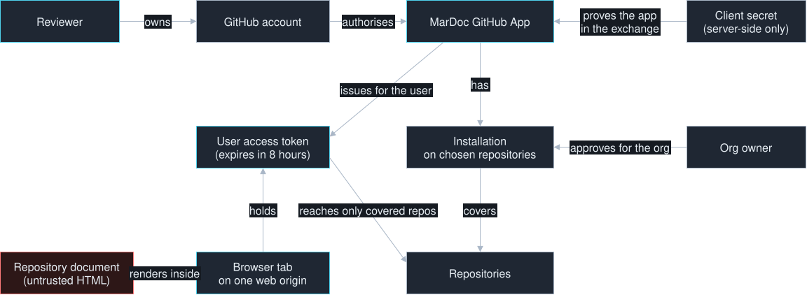
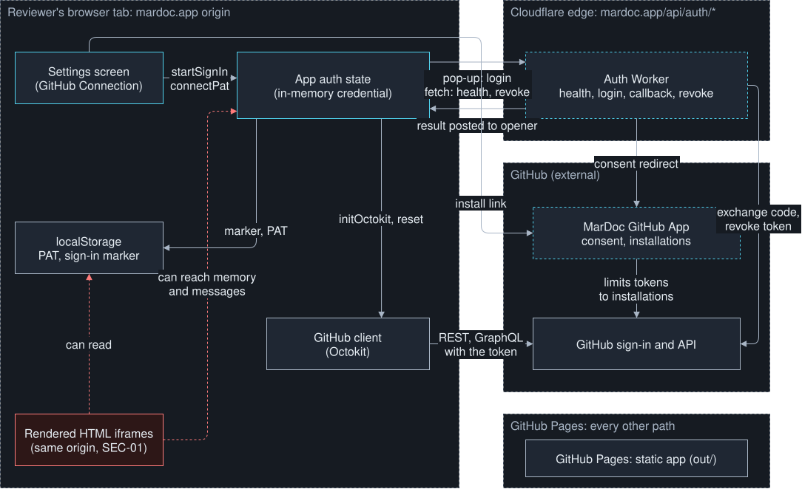
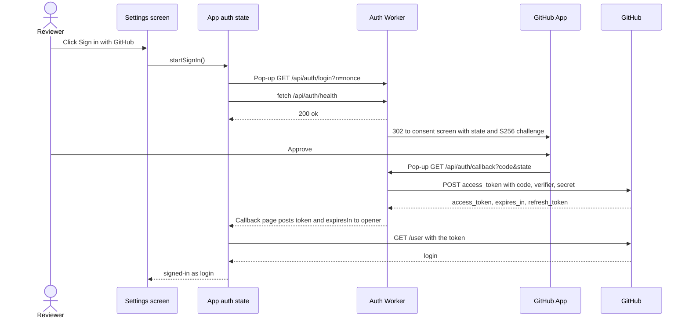
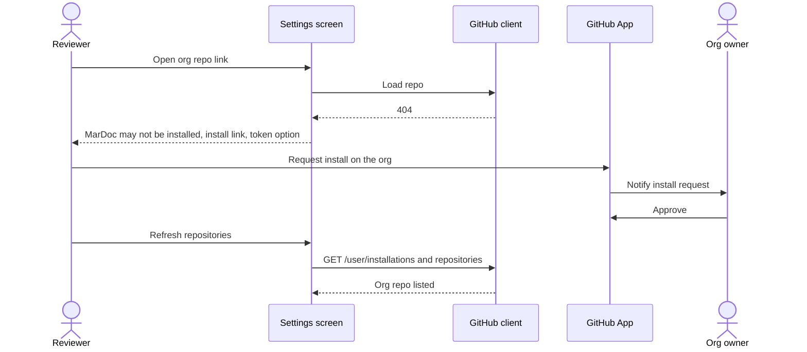
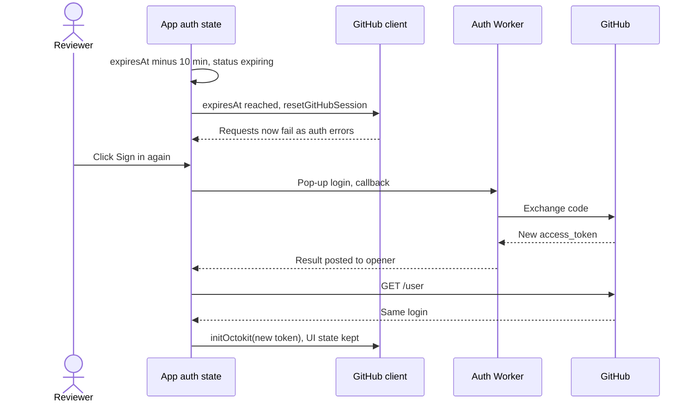
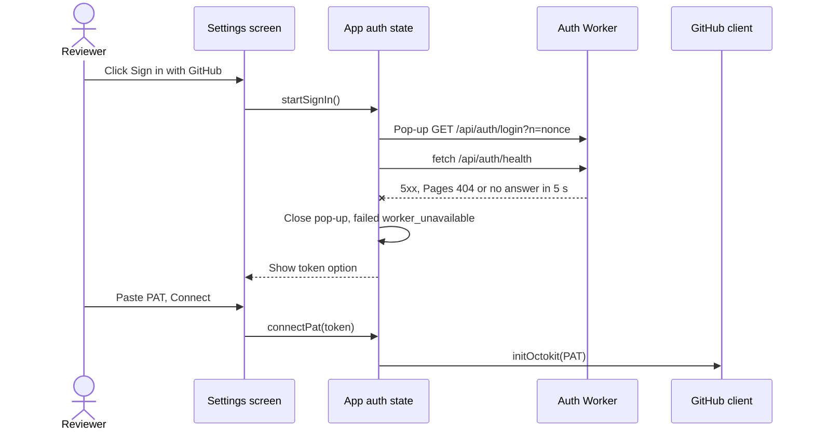

# GitHub sign-in: design

Level: L2 (technical record for the L1 [architecture page](architecture.html))

> Stage 1 of GitHub sign-in adds a **Sign in with GitHub** button that opens
> a small pop-up. The pop-up goes through a stateless Cloudflare Worker on
> `mardoc.app/api/auth/*` and the GitHub App's consent screen. The Worker
> hands an 8-hour access token back to the MarDoc tab that opened it, and the
> tab keeps the token in memory only. The tab never reloads, so the user
> stays where they were. When the token expires or the tab reloads, the user
> signs in again. A personal access token still works beside it.
>
> Start with [how the system works](architecture.html). This record follows
> the same order: why it matters, the problem domain, the parts, then
> sequences and special concerns, and their proof. It answers
> [requirements.md](requirements.md) and builds on the as-is
> baseline of the [GitHub connection](../github-connection/architecture.html)
> (R-2).

## Value and scope

**Who benefits and how:** new reviewers connect without making a token
(S-10, S-12). Every user gets an access token limited to the repositories
where MarDoc is installed, and it expires after 8 hours (S-13,
[GitHub docs](https://docs.github.com/en/apps/creating-github-apps/authenticating-with-a-github-app/refreshing-user-access-tokens)).

**Current pain and evidence:** connecting needs a pasted PAT
(`SettingsPanel.tsx:97-110` at `2b79817`), which stays in
`localStorage.mardoc_github_token` (`app-context.tsx:91, 286-318`), where a
rendered document's script can read it (SEC-01, RK-1). Issue #146 states the
need; there is no measurement of how many users stop at the PAT step
([L0 § Why](strategy.html#why)).

**Success signals:** a user with MarDoc installed is signed in with at most
2 clicks (F-11); the stage 1 gate finds no token in storage (F-30); every
existing PAT spec passes unchanged (F-50).

**In scope:** stage 1. That means Settings sign-in, the Worker's `health`,
`login`, `callback` and `revoke` routes, the in-memory session and its
expiry, the install link and messages, the PAT fallback and the
documentation changes (F-70 to F-72).

**Out of scope:** stage 2 silent refresh ([requirements § Stage 2 note](requirements.md#stage-2-note));
VS Code extension sign-in; the SEC-01 fix; moving hosting.

## Problem domain

### Context

A **reviewer** holds a GitHub account. The **MarDoc GitHub App** is
registered by MarDoc's owner, and users or org owners install it on chosen
repositories; an **installation** decides which repositories the App can
reach. A **user access token** that GitHub issues for the App can reach a
repository only when the reviewer can reach it *and* an installation covers
it, and it expires after 8 hours. GitHub issues that token only to a
server that presents the App's **client secret**. Its token endpoint sends
no CORS headers ([community #15752](https://github.com/orgs/community/discussions/15752)),
so MarDoc's static page cannot complete the exchange itself.

The tab that will hold the token also renders repository HTML on the same
origin (SEC-01), so whatever the tab holds, a document script can reach.



Editable source: [domain.drawio](diagrams/domain.drawio).

What makes this hard: the token must cross from a server-side step into one
browser tab without touching storage or a URL. That tab must be sure the
token answers the sign-in it started. The tab must cope with the token dying
after 8 hours (NF-12), or on reload, without losing the reviewer's place.

### Language and model

| Term | Meaning in this design |
|---|---|
| Credential | The one GitHub token a tab uses: a **PAT** (pasted), an **embed token** (from VS Code) or a **sign-in token** (from Sign in with GitHub). |
| Sign-in token | A GitHub App user access token, held in memory, with an expiry time. |
| Sign-in attempt | One click of Sign in with GitHub: a pop-up, a one-time value (the **attempt nonce**) and a deadline. |
| Sign-in result | The message the callback page posts back: the token and its lifetime, or an error code. |
| Session status | Where the tab's sign-in stands: `signed-out`, `signing-in`, `checking-user` (token received, waiting for `GET /user`), `signed-in`, `expiring`, `expired` or `sign-in-again` (after reload). A failed attempt returns to the status before it and sets `lastError`. |
| Installation | GitHub's record that the App may reach an account's chosen repositories. |
| Sign-in marker | `localStorage.mardoc_auth_method = "github-app"`: a non-secret hint that this browser used sign-in last (Q-20). |

### Rules that must hold

| ID | Domain rule / invariant | Requirements | Preserved by | Checked by |
|---|---|---|---|---|
| I-10 | A sign-in token is never written to web storage, a cookie the page can read, or a URL. | F-30, NF-11 | Session holds it in a closure; callback page posts it, never redirects with it | T-10, T-11 |
| I-11 | The tab accepts a sign-in result only when its origin is the app origin, its source is the attempt's pop-up, and its nonce equals the attempt nonce. | F-14 | Sign-in window adapter | T-12 |
| I-12 | The Worker contacts GitHub's token endpoint only after the callback's `state` equals the one in the attempt's cookie. | F-20 | Worker callback domain check | T-20 |
| I-13 | A refresh token never leaves the Worker's exchange step. | F-24, C-16 | Result shaping drops it | T-21 |
| I-14 | A tab has at most one active credential; a saved PAT is unused while a sign-in session lasts. | F-53 | Session status and `sessionKey` | T-13 |
| I-15 | The tab sends no GitHub request with a sign-in token at or after its expiry time. | F-33, NF-12 | Session expiry check before each request | T-14 |
| I-16 | The Worker never logs a token, code, verifier or secret. | NF-15 | No logging in the Worker | T-22 |
| I-17 | The callback page reflects no request input except a pattern-checked nonce and error code, serialised as JSON with `<`, `>` and `&` escaped. | F-23, NF-11 | Callback check; callback page template | T-21 |

## Solution at a glance

The click that starts sign-in opens a **pop-up** at `/api/auth/login`. The
Worker sets a short-lived cookie holding `state` and the PKCE verifier and redirects to
GitHub's consent screen. GitHub redirects back to `/api/auth/callback`,
where the Worker checks `state` and exchanges the code with the client
secret. It drops the refresh token and returns a tiny page that posts the
access token to `window.opener`, targeted at `https://mardoc.app`, then
closes. The MarDoc tab never navigates, so its route, open document and
unsaved edits stay put (S-15, S-16). GitHub's sign-in pages send no
`Cross-Origin-Opener-Policy` header (curl of `github.com/login` and
`/login/oauth/authorize`, 2026-10-21), so the opener should survive. SP-3
confirms it per browser (A-10).

The tab's **auth state** treats the sign-in token as a third kind of
credential beside the PAT and the embed token. It holds the token only in
memory, tracks its expiry, and moves the UI to Sign in again on expiry, on a
401 or after a reload. Signing in again as the same GitHub login replaces
the token without the reset that connecting does today
(`app-context.tsx:286-307`). The app gates on a **session key**
(`"pat"`, `"embed"`, `"sign-in:<login>"` or none), never on the token string,
so swapping a token for the same login re-runs no navigation
([App state by session status](#app-state-by-session-status)).

Trade-offs: a pop-up keeps the page alive but can be blocked, so Settings
opens it only from a click, and explains a blocked pop-up. Memory-only
tokens mean a reload costs one more click, the price of S-25 until stage 2.
The direction and its alternatives are in
[ADR 0001](../../adr/0001-web-sign-in-github-app-worker-route.md).

**Deployment assumption (C-10, C-12, ADR 0001):** the app runs in the
reviewer's browser, served by GitHub Pages. The Auth Worker runs on
Cloudflare's edge for `mardoc.app/api/auth/*` only. GitHub (github.com and
api.github.com) is external. No other server exists; documents never pass
through the Worker. If the route ever fails, the fallback host is
`auth.mardoc.app` (L0 proof 1), which would add cross-origin set-up to the
hand-off.

**Implementation snapshot:** `2b79817df4eb4929da6809f215ed4cb3750a37da`.
`src/` is unchanged since `2b94d90` (`git diff --stat 2b94d90 2b79817 -- src`
is empty), so the R-2 baseline describes it.

### Assumptions affecting the design

| Assumption in `requirements.md` | Design areas that change if it is wrong |
|---|---|
| A-10 | The hand-off moves to `BroadcastChannel("mardoc-sign-in")`, which has no `event.source`: I-11 rests on the nonce alone and every same-origin context can receive the token, so RK-1 grows. Needs its own ADR before it is built. |
| A-11 | With "Request user authorization during installation" on, the install tab lands on the callback with a code and no `state`; F-29's page must then also cover a `code` without `state`. |
| A-12 | No sign-in marker; the reload journey shows the signed-out Settings view; F-37 and F-38 drop. |
| A-13 | If a saved PAT is removed on sign-in, the session's start-up order loses its PAT branch for those users. |
| A-16 | `fetchUserRepos` keeps `GET /user/repos`; F-44 checks that list instead. |
| A-19 | F-16 and T-15 leave the stage 1 gate; RK-3 needs the owner's acceptance for stage 1. |

## Components



Editable source: [components.drawio](diagrams/components.drawio). Dashed
boxes are proposed; the others exist at the snapshot.

| Component | Responsibility | Owns | Interfaces / collaborators | Requirements |
|---|---|---|---|---|
| Settings screen | Offers sign-in and the PAT, shows who is signed in, links installs | Its view state | Calls auth state; links GitHub install page | F-10, F-13, F-17, F-18, F-55, F-41, F-44, F-50, F-53, F-54, F-71, F-72 |
| Sign-in banner | Shows expiring, expired and reload prompts over the main pane | Nothing | Reads session status; calls `startSignIn()` | F-32, F-33, F-37, F-38, NF-18, NF-22 |
| App auth state | Holds the active credential, its expiry and session status | Credential, session key, session status, attempt | Pop-up and `message`; `/api/auth/health`, `/revoke`; GitHub client | F-12, F-14, F-16, F-30 to F-38, F-51, F-52, F-60, F-61 |
| GitHub client (recap) | Sends GitHub requests with the current token | Octokit instance, caches | `initOctokit`, `resetGitHubSession` | F-40, F-60 |
| localStorage (recap) | Keeps the PAT and non-secret keys | `mardoc_github_token`, `mardoc_auth_method` | `safeStorage` | F-50, F-32 |
| Rendered HTML iframes (recap) | Show repository HTML on the app origin | Document scripts | Same-origin access to the tab (SEC-01) | RK-1 |
| Auth Worker | Exchanges the code for a token; revokes tokens | Nothing durable; 10-minute cookies | `/api/auth/*`; GitHub OAuth and API | F-20 to F-29, F-61 |
| GitHub Pages (recap) | Serves the static app | The `out/` build | HTTPS for every non-`/api/auth/*` path | C-10 |
| GitHub App | Defines what MarDoc may reach | Client ID, secret, permissions, installations | Consent screen, install page | C-11, NF-10, F-40 to F-44 |
| GitHub (recap) | Issues tokens and serves repositories | Accounts, repos, grants | `login/oauth/*`, REST and GraphQL | F-11, F-40 |

### Settings screen

**Responsibility:** the GitHub Connection tab of `SettingsPanel.tsx`. It
offers **Sign in with GitHub** first and the PAT behind "Use a personal
access token" (F-10, F-17). Its PAT instructions follow setup-github-pat.md
(F-54, Q-15). Signed in, it shows "Signed in with GitHub as
`<login>`", Disconnect and "Install MarDoc on more repositories" (F-13,
F-41). It shows failures with the PAT option and the guide link (F-51,
F-52, F-71).

**Owns:** whether the PAT form is open; nothing persistent.

**Interfaces and collaborators:** calls `startSignIn()` synchronously from
the button's click handler, because the pop-up must open inside the click to
pass pop-up blockers. Reads `session` from auth state. Calls `connectPat(token)`
(today's `setGithubToken(token)`) and `disconnect()`. With a PAT active it
shows "Connected with a personal access token" and, below it, Sign in with
GitHub; signing in leaves the saved PAT in place, unused until the sign-in
session ends (F-53). While signed in with a saved PAT, the view says "A saved
personal access token will be used after you disconnect", with "Remove
saved token" and "Disconnect and remove saved token" (F-55). The install link opens with `rel="noopener noreferrer"`.
When the installations cover nothing, the repository list shows F-44's
message. The help text replaces "there is no server" with the
data-and-security.md wording (F-72, Q-10).

**Does not do:** hold the token, open the pop-up itself or talk to the
Worker; auth state does. It is hidden in embed mode (F-15).

**Failure behavior:** every failure arrives as a session status with an
error code; the screen maps codes to text (table in
[Sign-in result codes](#sign-in-result-codes)) and always offers the PAT.

### Sign-in banner

**Responsibility:** part of the Settings screen's UI (drawn with it in the
diagram): a new strip above the main pane, in an `aria-live`
region (NF-22). It shows "Your GitHub sign-in ends in 10 minutes" with Sign
in again (`expiring`), "Your GitHub sign-in has ended" with Sign in again
(`expired`), and, after a reload, "Sign in again to open `<path>`" with
Sign in again and "Continue without signing in" (`sign-in-again`, F-37,
F-38). A deep-link 404 for a sign-in credential shows F-42's message in the
existing error area of the main pane.

**Owns:** nothing. **Interfaces:** reads the session status; calls
`startSignIn()` from its button's click. **Does not do:** hold state or
open the pop-up itself. **Failure behavior:** none of its own; attempt
failures appear in Settings and in the banner with the PAT option.

### App auth state

**Responsibility:** the credential part of `AppProvider`
(`app-context.tsx:144-146, 286-331` today), extended with a pure
**session model** (`src/lib/auth/session.ts`) and a browser **sign-in window
adapter** (`src/lib/auth/sign-in-window.ts`). It runs the attempt, accepts
the result (I-11), keeps the token in memory (I-10), watches expiry (I-15),
and decides between "same login: keep everything" and "new login: reset"
(F-35, F-36).

**Owns:** `credential: {kind: "pat" | "embed" | "sign-in", token, login?, expiresAt?} | null`,
held in a module closure, not React state; `lastLogin` (in memory, kept
through `expired`); the **session key**; `session` status; the current
attempt (pop-up handle, nonce, deadline).

**Interfaces and collaborators:**
- **Out to the pop-up:** `window.open("/api/auth/login?n=<nonce>", "mardoc-sign-in", "popup,width=600,height=720")`.
- **In from the pop-up:** `message` events of the [sign-in result](#sign-in-result-message) shape.
- **To the Worker:** `GET /api/auth/health` (5 s† timeout, F-51) and `POST /api/auth/revoke` on Disconnect (F-61).
- **To the GitHub client:** `initOctokit(token)` on sign-in and sign-in again; `resetGitHubSession()` on expiry and Disconnect.
- **To GitHub, through the client:** `GET /user` once after each result, to learn the login (F-13, F-35).
- **To localStorage:** only the sign-in marker (Q-20), and removal of `mardoc_user_repos` whenever the session key changes. A sign-in never writes or removes `mardoc_github_token` (I-10, F-53); `applySignInCredential` is a separate function from `setGithubToken`, which persists the token (`app-context.tsx:297`).

**Does not do:** store the token; render UI (Settings and the banner do);
check repository access (GitHub does).

**Failure behavior:** a blocked pop-up, a failed health check, a closed
pop-up, a timeout or an error result each end the attempt with
`session = failed(code)`; the existing credential, if any, is untouched.
On expiry or a 401 the status becomes `expired`. The tab keeps its route and
state, and requests fail fast with an auth error until the user signs in
again.

### GitHub client (recap)

Owned by the [GitHub connection baseline](../github-connection/architecture.html#parts).
Stage 1 changes three things:
- **Expiry check.** `initOctokit(token, {kind, expiresAt})` records the credential kind and expiry in module variables. The existing `hook.wrap("request")` (`github-api.ts:58-78`) first checks the expiry: when the credential is a sign-in token and `now ≥ expiresAt`, it throws an error with `status: 401` without sending, so `isAuthError` treats it as a 401 (I-15).
- **401 to `expired`.** The same hook calls a registered `onAuthError()` once per credential when a sign-in token gets a 401; auth state turns that into the `auth-error` event (F-34).
- **Messages and lists.** `formatApiError` reads the recorded kind and says "your GitHub sign-in has ended. Sign in again." for a sign-in token (F-34), and keeps today's text for a PAT. For a sign-in token, `fetchUserRepos` lists `GET /user/installations` and then `GET /user/installations/{id}/repositories` (A-16, F-40).

### localStorage (recap)

Owned by the baseline. Stage 1 adds one non-secret key, `mardoc_auth_method`
(Q-20), and writes no token for sign-in (I-10).

### Rendered HTML iframes (recap)

Owned by the baseline; SEC-01 owns the fix. A document script runs as
`mardoc.app`. It can read the in-memory token through the parent window, and
it can listen for `message` events on the parent. Stage 1 limits that
exposure to an 8-hour token covering installed repos; it does not remove it
(RK-1).

### Auth Worker

**Responsibility:** the only server-side step. `login` starts an attempt;
`callback` checks `state`, exchanges the code with the client secret and
PKCE verifier, and hands the access token to the opener. `revoke` deletes a
token at GitHub; `health` says it is routed (F-20 to F-27, F-61).

**Owns:** no durable state (F-26). One cookie per attempt, named by the
attempt's nonce so parallel attempts in several tabs don't overwrite each
other: `__Secure-mardoc_auth_<nonce>` holding `state` and the PKCE verifier,
with `HttpOnly; Secure; SameSite=Lax; Path=/api/auth; Max-Age=600`†,
cleared at the callback (F-28). `__Host-` would be stronger, but it needs
`Path=/`; with `__Secure-` a sibling host such as the fallback
`auth.mardoc.app` could overwrite the cookie, so adopting that host revisits
the cookie names. Config: `CLIENT_ID` and `APP_ORIGIN` vars, `CLIENT_SECRET`
secret (C-13).

**Interfaces and collaborators:** the routes in
[Worker routes](#worker-routes). Out to GitHub:
`POST https://github.com/login/oauth/access_token` (form-encoded, as the SP-1
Worker sends it; owner-reported) and `DELETE https://api.github.com/applications/{client_id}/token`
(basic auth). No CORS headers on any response (F-22). Every response has
`Cache-Control: no-store` (NF-14).

**Does not do:** store or return refresh tokens (I-13); call GitHub on
the user's behalf beyond the exchange and revoke; see documents; log
(I-16); serve any `/refresh` path (F-25).

**Failure behavior:** a GitHub error becomes a result with only the error
code. A network failure or 5xx from GitHub becomes `exchange_failed`. A
missing or mismatched cookie becomes `state_mismatch`. If the Worker itself
is down or unrouted, the pop-up shows a Cloudflare error or a Pages 404, and
the tab's health check catches it first (F-51).

### GitHub Pages (recap)

Serves every other path, unchanged (C-10). SP-1 criterion 2 proved it with
the route in place.

### GitHub App

**Responsibility:** GitHub's record of what MarDoc may do. It defines the
permissions (NF-10) and the callback URL, and it makes user tokens expire.
Its installations define which repositories a sign-in token reaches (F-40,
S-13).

**Owns:** client ID; client secret (copied once into Worker secrets); the
permission set (Contents read and write, Pull requests read and write,
Metadata read, Q-19); callback `https://mardoc.app/api/auth/callback`;
"Expire user authorization tokens" on; "Request user authorization (OAuth)
during installation" off and no Setup URL, so the install page does not
send the user to the callback (A-11); installations.

**Interfaces and collaborators:** the consent screen at
`/login/oauth/authorize`; the install page
`https://github.com/apps/<slug>/installations/new` (F-41). On that page an
org member who is not an owner can only request an install. GitHub then
notifies the org owners, who approve or decline (SP-1 criterion 5).

**Does not do:** run code; MarDoc does not use installation tokens or
webhooks in stage 1.

**Failure behavior:** a revoked or suspended App makes every sign-in token
fail with 401, so users see Sign in again and then a sign-in error, and the
PAT keeps working. A leaked secret is rotated by the runbook (NF-21, SP-2).
Only the owner registers or changes it (C-14).

### GitHub (recap)

Owned by GitHub. It issues the code and token, returns `expires_in` (28800
seconds, [GitHub docs](https://docs.github.com/en/apps/creating-github-apps/authenticating-with-a-github-app/refreshing-user-access-tokens))
for expiring user tokens, and answers 404 for a repository outside the
installation (SP-1 criterion 4, owner-reported until the report's Results
are filled).

## Interfaces and data

### Worker routes

All routes are `https://mardoc.app/api/auth/*`, with `Cache-Control:
no-store`, `Referrer-Policy: no-referrer`, `X-Content-Type-Options: nosniff`,
and no `Access-Control-*` headers.

| Route | Request | Response | Errors |
|---|---|---|---|
| `GET /health` | none | `200` JSON containing `"ok": true` (and `"version": "<git sha>"`) | none; absence is the signal |
| `GET /login?n=<nonce>` | `n`: base64url, 22 to 64 chars (`^[A-Za-z0-9_-]{22,64}$`); `Sec-Fetch-Site: same-origin` and `Sec-Fetch-Dest: document` | `302` to `https://github.com/login/oauth/authorize?client_id&redirect_uri=https://mardoc.app/api/auth/callback&state&code_challenge&code_challenge_method=S256`; sets the attempt cookie | `400` plain-text page if `n` fails the pattern (no message can be posted without a nonce); `403` plain-text page if the `Sec-Fetch-*` headers are missing or different, so other sites and fetches can't start attempts. It also expires every `__Secure-mardoc_auth_*` cookie on the request except the newest two, so repeated starts can't pile cookies up |
| `GET /callback?code&state` or `?error&state` | GitHub's redirect, plus the attempt cookie | `200 text/html` callback page carrying a [sign-in result](#sign-in-result-message); clears the cookie | Result codes below; never a redirect |
| `GET /callback?installation_id&setup_action` with no `state` | The install page's return, if GitHub sends one (A-11) | `200 text/html` "MarDoc is installed. Go back to the MarDoc tab and press Refresh." No script, no exchange (F-29) | — |
| `POST /revoke` | `Origin: https://mardoc.app`, `Content-Type: application/json`, body `{"token":"…"}` | `204`; also `204` when GitHub answers 404 (token already expired or revoked) | `403` when `Origin` is missing or different; `400` on a bad body; `502 {"error":"revoke_failed"}` on other GitHub failures |
| anything else, including `/refresh` | — | `404` | — |

**Values.** `state` = `<nonce>.<r>`, where `r` is 32 random bytes,
base64url (43 characters). The nonce is not secret; carrying it in `state`
lets the callback name the attempt even when the cookie is gone. The PKCE
verifier is 32 random bytes, base64url (43 characters,
[RFC 7636](https://www.rfc-editor.org/rfc/rfc7636#section-4.1)). The CSP
nonce is 16 random bytes per response.

**Callback page.** It has `Content-Security-Policy: default-src 'none';
script-src 'nonce-<random>'; base-uri 'none'; form-action 'none';
frame-ancestors 'none'`. The result is serialised with `JSON.stringify`,
with `<`, `>` and `&` escaped as `\u003c`, `\u003e` and `\u0026`, into a
`<script type="application/json" id="result">` element. The one nonce'd
script parses that element, runs `window.opener.postMessage(result,
APP_ORIGIN)` and then `window.close()`. The page reflects no other input
(I-17). If `window.opener` is null it shows "Return to MarDoc and try
again"; the `BroadcastChannel` fallback needs its own ADR (A-10).

**Free-plan exhaustion.** `/login` is unauthenticated, so a script could
spend the Free plan's 100,000 daily requests (NF-17). Sign-in then fails
as `worker_unavailable` and the PAT still works. The runbook sets a
Cloudflare usage notification at 50% of the daily limit.

### Sign-in result message

```json
{ "type": "mardoc-sign-in-result", "v": 1, "nonce": "<attempt nonce>",
  "ok": true, "token": "ghu_…", "expiresIn": 28800 }
{ "type": "mardoc-sign-in-result", "v": 1, "nonce": "<attempt nonce>",
  "ok": false, "error": "access_denied" }
```

`nonce` is the part of `state` before the first `.`, if it matches the
nonce pattern; otherwise it is `null`, and the tab ignores the message (I-11)
and later reports `window_closed` with the PAT option.

### Sign-in result codes

| Code | Raised by | Settings shows |
|---|---|---|
| `access_denied` | GitHub (user cancelled) | "Sign-in was cancelled." |
| `state_mismatch` | Worker | "Sign-in could not be verified. Check that cookies are allowed for mardoc.app, then try again." |
| `bad_verification_code`, other GitHub `error` matching `^[a-z_]{1,40}$` | GitHub | "GitHub rejected the sign-in (`<code>`). Try again." |
| `exchange_failed` | Worker (network or 5xx to GitHub, or an `error` value outside the pattern) | "GitHub did not answer. Try again." |
| `non_expiring_token` | Worker (token without `expires_in`: App misconfigured) | "Sign-in is misconfigured." |
| `popup_blocked` | Tab | "Allow pop-ups for mardoc.app, or use a token." |
| `worker_unavailable` | Tab (health check) | "Sign-in with GitHub is unavailable right now." |
| `timeout` | Tab (10 minutes†, F-28) | "Sign-in took too long. Try again." |
| `window_closed` | Tab (pop-up closed and no result within 1 s†, F-52) | "The sign-in window closed. Try again, or use a token." |
| `cancelled` | Tab (user kept unsaved changes) | "Sign-in cancelled; your changes are kept." |

Every row shows the PAT option (F-51, F-52).

### Data

| Data concept | Representation or store | Owner | Constraints / lifecycle | Requirements |
|---|---|---|---|---|
| Sign-in token | JS memory in the auth module and the Octokit instance; never React state | App auth state | Lives until expiry, Disconnect, sign-in again or reload | F-30, I-10 |
| Expiry time | `receivedAt + expiresIn·1000 − margin`, with `margin = min(60 s†, expiresIn·100 ms)` | App auth state | The margin covers clock and transit skew without swallowing a short test lifetime | F-33, I-15 |
| Attempt | `{popup, nonce, deadline}` in memory | App auth state | One per tab; a second click focuses the open pop-up | F-14 |
| Attempt cookie | `__Secure-mardoc_auth_<nonce>`, `HttpOnly`, on `/api/auth` | Auth Worker | 10 minutes†; cleared at callback | F-28 |
| Saved PAT | `localStorage.mardoc_github_token` | App auth state | Unchanged by sign-in; unused while a sign-in session lasts | F-50, F-53 |
| Sign-in marker | `localStorage.mardoc_auth_method` | App auth state | Set on sign-in; removed on Disconnect, on "Continue without signing in", and when a PAT is connected | F-32, F-38 |
| Refresh token | Not kept | — | Dropped inside the exchange (I-13) | F-24 |

### App state by session status

The rest of the app reads these values; the token itself is never in React
state. `hasCredential` replaces today's `isAuthenticated = !!githubToken`
(`app-context.tsx:182`) at its gating sites, and the hash-route effect
(`app-context.tsx:765-784`) depends on `sessionKey` instead of
`githubToken`, so a same-login token swap does not re-open the document.

| Session status | `sessionKey` | `hasCredential` | `isDemoMode` | Octokit | Main pane |
|---|---|---|---|---|---|
| `signed-out` | none, or `"pat"` / `"embed"` when one is active | as today | as today | as today | as today |
| `signing-in` | unchanged from before the attempt | unchanged | unchanged | unchanged | unchanged |
| `checking-user` | unchanged | unchanged | unchanged | unchanged (new token not yet applied) | unchanged |
| `signed-in`, `expiring` | `"sign-in:<login>"` | true | false | sign-in token | normal |
| `expired` | unchanged | true | false | reset; requests fail as auth errors | unchanged, banner shows |
| `sign-in-again` | none | false | false | none | F-37 prompt for the route; no demo data |
| after a failed attempt | as before the attempt | as before | as before | as before | as before; `lastError` in Settings and banner |

## Key behavior: system journeys

Mermaid sources are in `diagrams/*.mmd`; the explainer embeds their SVGs.

### Start-up with a sign-in marker (F-31, F-32, F-37, F-38)

1. **App auth state** finds no PAT and finds `mardoc_auth_method =
   "github-app"`. It sets `session = sign-in-again` and keeps the hash route
   without loading demo data.
2. **Sign-in banner** shows "Sign in again to open `<path>`", with Sign in
   again and "Continue without signing in". The second removes the marker
   and shows demo data. Unsaved edits from before the reload survive only
   where drafts already do (Markdown files in repositories), not HTML files
   or unsent PR comments.

### "I sign in for the first time" (F-10 to F-14, F-20 to F-24, F-30)

1. **Settings screen** receives the click and calls `startSignIn()`.
2. **App auth state** makes a nonce from 16 random bytes and opens the pop-up at
   `/api/auth/login?n=<nonce>`. At the same moment it fetches
   `/api/auth/health`.
3. **Auth Worker** (`login`) creates `state` (`<nonce>.<random>`) and the
   PKCE verifier, sets the attempt cookie and redirects the pop-up to
   GitHub's consent screen.
4. **GitHub** shows the consent screen for the **GitHub App**. The reviewer
   approves, and GitHub redirects the pop-up to `/api/auth/callback?code&state`.
5. **Auth Worker** (`callback`) compares `state` with the cookie (I-12). It
   posts the code, verifier and secret to GitHub's token endpoint, gets
   `access_token`, `expires_in` and `refresh_token`, and drops the refresh
   token (I-13). It returns the callback page.
6. **Callback page** posts the result to the opener with target
   `https://mardoc.app` and closes.
7. **App auth state** accepts the result (I-11), calls `GET /user` with the
   new token, then `applySignInCredential`: `initOctokit(token, {kind:
   "sign-in", expiresAt})`, `sessionKey = "sign-in:<login>"`, marker set.
   It moves to `signed-in`. A saved PAT stays in storage, unused (F-53). The
   route and open document are untouched (F-12).
8. **Settings screen** shows "Signed in with GitHub as `<login>`"; the repo
   picker loads from the installations (F-40), or shows F-44's message when
   they cover nothing.



### "I sign in, but my org hasn't installed MarDoc" (F-40 to F-43)

1. **App auth state** completes sign-in as above.
2. **GitHub client** lists installations; the org is not among them, so the
   repo picker lacks the org's repos (F-40). Opening a link to an org repo
   gets 404, and the main pane says MarDoc may not be installed on
   `<owner>/<repo>`, with the install link and the PAT option (F-42).
3. The reviewer opens `https://github.com/apps/<slug>/installations/new` in
   a new tab. **GitHub App**: they choose the org; not being an owner, they
   can only send a request, and GitHub notifies the org owners.
4. An **org owner** approves on GitHub. The installation now covers the
   repo. If GitHub returns the install tab to `/api/auth/callback` with
   `installation_id` and no `state`, the Worker shows "MarDoc is installed.
   Go back to the MarDoc tab and press Refresh." (F-29).
5. The reviewer clicks Refresh. **GitHub client** lists installations
   again with the same token, and the repo appears (F-43; SP-1
   criterion 5, owner-reported).



### "My token expires mid-review" (F-33 to F-36)

1. **App auth state** reaches `expiresAt − 10 min`† and sets `expiring`;
   the banner offers Sign in again (A-18).
2. At `expiresAt` it sets `expired` and resets the GitHub client.
   `sessionKey` keeps its value, so no navigation re-runs; the route, open
   document and unsaved edits stay. Any request fails as an auth error
   (I-15). A 401 before then has the same effect through `onAuthError`
   (F-34).
3. The reviewer clicks Sign in again. The attempt runs as in the first
   journey. GitHub has recorded the authorisation, so it usually redirects
   straight back without a consent screen (inferred; SP-3 measures it).
4. **App auth state** gets the new token, calls `GET /user`, and compares
   the login with `lastLogin`. If it is the same, it calls only
   `initOctokit(token, …)`; `sessionKey` is unchanged, so nothing reloads
   and the dirty editor keeps its text (F-35). If it differs, it runs the
   full reset that connecting does, without persisting the token (F-36).



### "Sign-in is down, so I use a token" (F-27, F-50 to F-52)

1. **App auth state** opens the pop-up and fetches `/api/auth/health`.
2. The **Auth Worker** is down or unrouted: health returns a Cloudflare 5xx,
   a GitHub Pages 404 (HTML with `x-github-request-id`), or no answer within
   5 s† (F-51).
3. **App auth state** closes the pop-up and sets
   `failed(worker_unavailable)`.
4. **Settings screen** says sign-in is unavailable, opens the token form
   and links the PAT guide. The reviewer pastes a PAT, which is saved and
   used as today (F-50).



**Other failure journeys** (each ends in `failed(code)` with the PAT
option, and the existing credential is kept): pop-up blocked
(`popup_blocked`); reviewer cancels (`access_denied`); cookies missing or
`state` forged (`state_mismatch`); GitHub token endpoint down
(`exchange_failed`); pop-up closed with no result within 1 s†
(`window_closed`); 10 minutes† pass (`timeout`). A result from another
window, or carrying another attempt's nonce, is ignored (I-11) and the
attempt continues. I-11 does not protect against a same-origin document
script, which can read the token from the tab's memory directly (RK-1).

## Critical algorithms and state transitions

### Session status (App auth state, `src/lib/auth/session.ts`)

**Purpose and contract:** a pure function `next(state, event, now)` that
returns the new state and the effects to run. It holds no timers and makes
no I/O, so tests drive it with a fake clock (LR-10). The function is total:
any (status, event) pair not listed leaves the state unchanged and runs no
effect.

**Decision order at start-up:** an embed token wins over everything
(`applyInitData` at `app-context.tsx:324-331`). Next, a saved PAT: the state
is `signed-out` with `sessionKey = "pat"` (F-50). Next, the marker:
`sign-in-again`. Otherwise `signed-out` with no credential.

**Same login:** `lastLogin` is the login of the last sign-in credential in
this tab, kept through `expiring` and `expired`, and cleared by Disconnect
and by connecting a PAT. A PAT or embed credential, or a fresh tab, has no
`lastLogin`, so the result counts as a new login.

**Failure:** `failed(code)` in the table is shorthand: the status returns to
`statusBeforeAttempt`, saved by `start`, and `lastError = code` is set.
Settings and the banner show `lastError`, with the PAT option, until the
next attempt. So a blocked pop-up while `expiring` stays `expiring`, and
the banner still moves to "ended" at expiry.

| From | Event | To | Effects |
|---|---|---|---|
| any except `signing-in`, `checking-user` | `start` | `signing-in` | save `statusBeforeAttempt`; clear `lastError`; open pop-up; if `null` → `failed(popup_blocked)`; health check; deadline at 10 minutes† (F-28) |
| `signing-in` | `start` | `signing-in` | focus the open pop-up |
| `signing-in` | `health-failed` | `failed(worker_unavailable)` | close pop-up |
| `signing-in` | `result` with wrong source or nonce | `signing-in` | ignore |
| `signing-in` | `result(ok)` | `checking-user` | cancel the close grace; `GET /user` with the new token, not yet applied; deadline 10 s† (F-52) |
| `signing-in` | `result(error code)` | `failed(code)` | previous credential untouched |
| `signing-in` | `popup-closed` | `signing-in` | wait 1 s† for a result (F-52) |
| `signing-in` | `popup-closed` and 1 s† passed | `failed(window_closed)` | PAT option (F-52) |
| `signing-in` | `deadline` | `failed(timeout)` | close pop-up |
| `checking-user` | `popup-closed` | `checking-user` | ignore |
| `checking-user` | `user(login = lastLogin)` | `signed-in` | `initOctokit(new token)`; set `sessionKey = "sign-in:<login>"` if it is none; keep UI; schedule expiry |
| `checking-user` | `user(other login)`, editor clean | `signed-in` | `applySignInCredential`: full UI reset as `setGithubToken` does, without writing `TOKEN_KEY`; `sessionKey = "sign-in:<login>"`; `lastLogin = login`; remove `mardoc_user_repos`; set marker; schedule expiry |
| `checking-user` | `user(other login)`, editor dirty | `checking-user` | ask through `guardNavigation`: "Signing in as `<login>` closes the open document. Discard unsaved changes?" Confirm → the clean row; cancel → `failed(cancelled)`, new token discarded |
| `checking-user` | `user-failed` (401, network) or 10 s† deadline (F-52) | `failed(exchange_failed)` | discard the new token; previous credential untouched |
| any except `signing-in`, `checking-user` | `result` or `user` | unchanged | ignore (late event) |
| `signed-in` | `now ≥ expiresAt − 10 min`† | `expiring` | banner |
| `signed-in`, `expiring` | `now ≥ expiresAt` or `auth-error` | `expired` | reset the GitHub client; keep `sessionKey` |
| `sign-in-again` | `continue-without` | `signed-out` | remove marker; demo data |
| any | `connect-pat` | `signed-out` with `sessionKey = "pat"` | today's `setGithubToken(token)`; clear `lastLogin`; remove marker and `mardoc_user_repos` |
| any with a sign-in credential | `disconnect` | `signed-out` | `POST /revoke` (best effort, 5 s†, F-61); reset; clear `lastLogin` and `sessionKey`; remove marker and `mardoc_user_repos`; a saved PAT becomes active, as the signed-in view said (F-53, F-55) |
| any with a sign-in credential | `disconnect-and-remove-pat` | `signed-out` | as `disconnect`, then remove `mardoc_github_token`; no credential (F-55) |
| any with a PAT or embed credential | `disconnect` | `signed-out` | today's `setGithubToken(null)`; remove marker |

**Worked examples:** a result arrives at 12:00:00 with `expiresIn: 28800`,
so the margin is 60 s (F-33) and `expiresAt` is 19:59:00. The status moves to
`expiring` at 19:49:00. A request sent at 19:59:00 is refused by the hook
without leaving the tab. In a test, `expiresIn: 90` gives a 9 s margin and
`expiresAt` 81 s after receipt. A result posted by an iframe with a copied
nonce has `event.source` equal to the iframe, not the pop-up, and is
ignored. A PAT user signing in as their own login has no `lastLogin`, so
the full reset runs, the PAT-era repo list is cleared, and the PAT stays
saved.

**Hard cases:** a laptop that sleeps past expiry: timers fire late, but the
request hook checks `now`, and `visibilitychange` re-runs the check. If the
reviewer starts sign-in again while the token is still valid, the old token
stays in use until the new one arrives. Two MarDoc tabs share the browser's
cookies, so each attempt uses its own cookie name (`__Secure-mardoc_auth_<nonce>`)
and both can sign in at once; each tab holds its own token.

**Cost and bounds:** one attempt per tab; four timers at most.

### Callback check (Auth Worker, `worker/src/domain/callback.ts`)

**Purpose and contract:** given the query, the cookies and an exchange
port, produce a sign-in result or the install page. Pure apart from the port
(LR-11).

**Decision order:**
1. No `state` and an `installation_id` → the install page (F-29). No
   `state` otherwise → `state_mismatch`, `nonce: null`.
2. Take the nonce as the part of `state` before the first `.`. If it fails
   the nonce pattern → `state_mismatch`, `nonce: null`.
3. No cookie named for that nonce, or its `state` differs from the query's
   (constant-time compare) → `state_mismatch` with that nonce, and no
   exchange (I-12).
4. `error` in the query → that code if it matches `^[a-z_]{1,40}$`, else
   `exchange_failed`.
5. No `code` → `state_mismatch`.
6. Exchange. A JSON `error` → that code, under the same pattern. A network
   error or non-2xx → `exchange_failed`. No `expires_in` →
   `non_expiring_token`. Otherwise `ok` with `access_token` and
   `expires_in`, dropping all other fields (I-13).

**Worked examples:** `?code=c&state=N.s`, with a cookie for `N` holding
`N.s`, and GitHub returning `{access_token, expires_in: 28800,
refresh_token}` gives `{ok: true, token, expiresIn: 28800}`, and the page
contains no `ghr_`. `?code=c&state=N.x` with the cookie holding `N.s` gives
`state_mismatch` with nonce `N`, and no outbound request.
`?error=<script>&state=N.s` with a matching cookie gives `exchange_failed`.

## Cross-cutting needs that shape this solution

### Security and privacy

- **Assets:** the sign-in token (8 hours per NF-12, installed repos); the client
  secret (Worker only); the PAT (unchanged).
- **Boundaries:** tab ↔ Worker (same origin, cookies scoped to `/api/auth`);
  Worker ↔ GitHub (server-side HTTPS); tab ↔ pop-up (`postMessage` with
  fixed target origin and nonce).
- **Login CSRF:** `state` cookie match (I-12) stops a forged callback; the
  nonce and `event.source` (I-11) stop a result from another window or
  attempt from being accepted. Neither protects against a same-origin
  document script, which can read the token directly (RK-1).
- **Callback page injection:** the page is the one place on `mardoc.app`
  that echoes request input. It echoes only the nonce (pattern-checked) and
  an error code (pattern-checked), serialised as escaped JSON (I-17).
- **Token leakage:** no URL, history, storage or cookie carries it (I-10,
  NF-11). The callback page's CSP allows only its own nonce script and
  `frame-ancestors 'none'` stops framing.
- **Same-origin documents (RK-1, SEC-01):** a rendered document script can
  still read the in-memory token or listen on the parent window. Stage 1
  leaves RK-1 open, bounded by 8 hours and installed repos; stage 2 waits for
  the fix.
- **Forged `init` (RK-3):** today a document can post `init` and replace the
  credential (`app-context.tsx:353-376`). F-16 requires the embed-mode and
  parent-window checks for `init` in stage 1 (T-15). The owner accepted
  Q-27's default (2026-10-27), so stage 1 ships only with these checks.
- **Third party (RK-2):** Cloudflare runs the Worker and could see tokens.
  The Worker logs nothing (I-16); F-70 says so in the docs.
- **Revoke route abuse:** it needs the token itself, so a caller can only
  revoke a token it already holds. The `Origin` check keeps it from being an
  open relay.

### Operations, reliability and rollout

- **Deploy:** the owner runs `wrangler deploy` for `worker/` from a tagged
  commit (A-17, C-14). The app ships through the existing Pages deploy, in
  either order: an app that ships before the Worker meets
  `worker_unavailable` and offers the PAT (F-51).
- **Rollback:** remove the Worker route. Health then fails, and Settings
  falls back to the PAT (F-51). Sign-in tokens already issued work until
  expiry.
- **Secret rotation:** the runbook from SP-2 (NF-21).
- **Observability:** Cloudflare's per-Worker request and error counts only;
  no logs (I-16). The owner checks them at milestone close (NF-17).
- **Local development:** Playwright mocks `/api/auth/*` (NF-19); the
  development App with a localhost callback is for `wrangler dev` (A-15).
  One Playwright run drives the real Worker module under `wrangler dev`
  with GitHub stubbed, so the real callback page posts to the real tab
  (T-32).
- **Build prerequisites (first work package):** none of this exists at the
  snapshot. `worker/` gets its own `tsconfig.json` and the root
  `tsconfig.json` excludes it, so `next build` does not type-check Worker
  code against the DOM library. A layout-check script for LR-10 and LR-11
  joins `npm run ci`, with the Worker tests. New dev dependencies (wrangler,
  Workers types, a test runner) are listed with a reason and reviewed as a
  supply-chain change. The Worker tests run under plain Vitest in Node (no
  Workers test pool), with `wrangler`, `@cloudflare/workers-types`,
  `typescript` and `vitest` pinned exactly in `worker/package.json`; the
  real runtime is covered by T-32.

### Layout rules

| ID | Rule | Checked by |
|---|---|---|
| LR-10 | `src/lib/auth/session.ts` imports nothing from React, `window`, `document`, `localStorage` or `fetch`. | T-30, checked in `ci` by `scripts/check-layout.mjs` |
| LR-11 | `worker/src/domain/**` makes no `fetch` and reads no `env`; GitHub calls go through `worker/src/adapters/github.ts`. | T-30, checked in `ci` by `scripts/check-layout.mjs` |

## Decisions and accepted risks

- **[ADR 0001](../../adr/0001-web-sign-in-github-app-worker-route.md):** GitHub App plus Worker route; stage 1 without refresh.
- **Q-8 (pop-up hand-off):** recorded as an ADR when the owner accepts this design and SP-3 reports. A `BroadcastChannel` fallback needs its own ADR (A-10).
- **RK-1** (SEC-01), **RK-2** (Cloudflare in the credential path), **RK-3** (forged `init`): open in [risks.md](../../risks.md); none is accepted by this design. RK-3 is closed for stage 1 only if F-16 ships (Q-27).

## Verification

| ID | Level | What it proves | Requirements / rules |
|---|---|---|---|
| T-10 | Playwright, mocked exchange | After sign-in no web storage or readable cookie holds the token (stage 1 gate) | F-30, I-10 |
| T-11 | Playwright + Worker unit | No URL, history entry, resource name or `Location` header holds the token | NF-11, I-10, F-23 |
| T-12 | Unit + Playwright | Results from another window, an iframe or with a wrong nonce are ignored | F-14, I-11 |
| T-13 | Playwright | Sign-in with a saved PAT keeps it unused; the signed-in view says it will be used after Disconnect; Disconnect makes it active again; "Disconnect and remove saved token" removes it | F-53, F-55, I-14 |
| T-14 | Unit (fake clock) + Playwright | Every row of the session table; no request carries a token at or after `expiresAt`; a 401 gives `expired` and the sign-in message; same-login sign-in again with a dirty editor re-fetches nothing and keeps edits | F-31 to F-38, I-15, NF-12 |
| T-15 | Playwright | `init` from a non-parent window or outside embed mode is ignored | F-16, RK-3 |
| T-16 | Playwright | Settings layout: Sign in first, Sign in offered under an active PAT, PAT behind its control, signed-in view, install link with `noopener`, empty-installations message, no "no server" copy, hidden in embed mode | F-10, F-13, F-15, F-17, F-18, F-41, F-44, F-71, F-72 |
| T-17 | Playwright, mocked exchange | Deep-linked route and file survive sign-in | F-12 |
| T-18 | Playwright, mocked failures | Each result code shows its message and the PAT option within 5 s†; keyboard reach and `aria-live` | F-42, F-51, F-52, NF-13, NF-18, NF-22 |
| T-19 | e2e suite | Existing PAT-seeded specs pass unchanged | F-50, C-17 |
| T-20 | Worker unit (stubbed GitHub) | Each step of the callback decision order; state mismatch → no exchange; S256 challenge; no CORS headers; install return page without exchange | F-20, F-21, F-22, F-29, I-12 |
| T-21 | Worker unit | Refresh token absent from every response; `/refresh` is 404; result posted only to `APP_ORIGIN`; a hostile `error` or `state` value never appears unescaped in the page | F-23, F-24, F-25, I-13, I-17 |
| T-22 | Worker unit | `console` never called; every response `no-store`; attempt cookie `Max-Age=600` then `0`; `/login` refuses a cross-site or non-document request and keeps at most three attempt cookies; no storage bindings in `wrangler.toml` | F-26, F-28, NF-14, NF-15, I-16 |
| T-23 | Worker unit | Health JSON contains `ok: true`; revoke refuses a missing or foreign `Origin`, maps GitHub 404 to 204, and calls GitHub with basic auth | F-27, F-61 |
| T-24 | Unit | Disconnect drops the token, resets the client and caches, removes the marker | F-60, F-32 |
| T-32 | Playwright, real Worker under `wrangler dev`, GitHub stubbed | The real callback page posts to the real tab; CSP allows the nonce script; the pop-up closes | F-14, F-23, NF-19 |
| T-33 | Review | In-app PAT instructions match the guide; data-and-security.md lists `mardoc_auth_method`; known-issues.md describes the sign-in 401 path | F-54, F-73 |
| T-25 | Live probe (owner) | `/` serves Pages; `/api/auth/health` is the Worker; `/refresh` 404; `no-store` | C-10, C-12, F-25, NF-14 |
| T-26 | Owner demo | Click count, installed-only picker, org request journey, revoke, latency, browsers, permissions | F-11, F-40, F-43, F-61, NF-10, NF-16, NF-20, C-11 |
| T-27 | Review | No `client_secret` value in repo or `out/`; secret read only from `env`; no agent deploy commands | C-13, C-14 |
| T-28 | Doc check | README, data-and-security.md, capabilities.md name the Worker and Cloudflare | F-70 |
| T-29 | Owner check | Free plan and request counts; rotation runbook present | C-15, NF-17, NF-21 |
| T-30 | ci layout check | LR-10 and LR-11 hold | LR-10, LR-11 |
| T-31 | ci | `npm run ci` runs every sign-in journey with GitHub and `/api/auth/*` mocked | NF-19 |

## Traceability

| Requirement | Design elements | Verified by |
|---|---|---|
| C-10 | Deployment assumption; GitHub Pages recap | T-25 |
| C-11 | GitHub App | T-26 |
| C-12 | Auth Worker; Worker routes | T-25 |
| C-13 | Auth Worker config | T-27 |
| C-14 | Operations: deploy | T-27 |
| C-15 | Operations | T-29 |
| C-16 | I-13; Worker routes (no `/refresh`) | T-21 |
| C-17 | Settings screen; session decision order | T-19 |
| F-10 | Settings screen | T-16 |
| F-11 | First sign-in journey | T-26 |
| F-12 | Pop-up hand-off; first sign-in step 7 | T-17 |
| F-13 | Settings screen | T-16 |
| F-14 | I-11; sign-in window adapter | T-12, T-32 |
| F-15 | Settings screen (embed) | T-16 |
| F-16 | Security: forged `init` | T-15 |
| F-17 | Settings screen | T-16 |
| F-20 | I-12; callback check | T-20 |
| F-21 | Worker `login` | T-20 |
| F-22 | Worker routes (no CORS) | T-20 |
| F-23 | Callback page target origin | T-11, T-21 |
| F-24 | I-13; callback check step 5 | T-21 |
| F-25 | Worker routes | T-21, T-25 |
| F-26 | Auth Worker owns | T-22 |
| F-27 | Worker `health` | T-23 |
| F-28 | Auth Worker owns; attempt cookie | T-22 |
| F-29 | Worker routes (install return) | T-20 |
| F-30 | I-10; data table | T-10 |
| F-31 | Session status; start-up | T-14 |
| F-32 | Sign-in marker; start-up journey | T-14, T-24 |
| F-33 | I-15; expiry journey | T-14 |
| F-34 | GitHub client recap (`formatApiError`); session `auth-error` | T-14 |
| F-35 | Session `user(login = lastLogin)`; app state table | T-14 |
| F-36 | Session `user(other login)` | T-14 |
| F-37 | Sign-in banner; app state table | T-14 |
| F-38 | Session `continue-without` | T-14 |
| F-40 | GitHub client recap (installations); GitHub App | T-26 |
| F-41 | Settings screen; GitHub App | T-16 |
| F-42 | Org install journey step 2 | T-18 |
| F-43 | Org install journey step 5 | T-26 |
| F-44 | Settings screen (empty installations) | T-16 |
| F-50 | Settings screen; decision order | T-19 |
| F-51 | Worker-down journey | T-18 |
| F-52 | Result codes | T-18 |
| F-53 | I-14; Settings screen; session `disconnect` | T-13 |
| F-54 | Settings screen | T-33 |
| F-55 | Settings screen; session `disconnect-and-remove-pat` | T-13 |
| F-18 | Settings screen | T-16 |
| F-60 | Session `disconnect` | T-24 |
| F-61 | Worker `revoke` | T-23, T-26 |
| F-70 | Security: third party | T-28 |
| F-71 | Settings screen | T-16 |
| F-72 | Settings screen | T-16 |
| F-73 | Docs | T-33 |
| NF-10 | GitHub App owns | T-26 |
| NF-11 | I-10; callback page | T-11 |
| NF-12 | I-15 | T-14 |
| NF-13 | Worker-down journey | T-18 |
| NF-14 | Worker routes | T-22, T-25 |
| NF-15 | I-16 | T-22 |
| NF-16 | First sign-in journey | T-26 |
| NF-17 | Operations: observability | T-29 |
| NF-18 | Settings screen; sign-in banner | T-18 |
| NF-19 | Operations: local development | T-31, T-32 |
| NF-20 | Pop-up hand-off; SP-3 | T-26 |
| NF-21 | Operations: secret rotation | T-29 |
| NF-22 | Sign-in banner (`aria-live`) | T-18 |

## Open questions

The owner-facing questions are in [requirements.md § Open questions](requirements.md#open-questions)
(Q-8, Q-19 to Q-28). This record adds none. SP-3 settles A-10 before the
hand-off is built.
