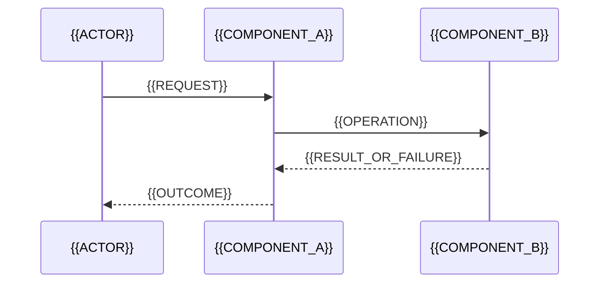

# MarDoc Design

> {{ONE_PARAGRAPH_SUMMARY}}
>
> This document connects the intended value, the problem domain, the solution,
> and its proof. It answers [requirements](requirements.md), describes the
> current design in present tense, and links to ADRs, risks, UX, API, and deeper
> component designs where relevant. Omit sections that do not shape this
> design; do not fill them just to satisfy a template.

## Value and scope

**Who benefits and how:** {{BENEFICIARIES_AND_OUTCOME}}

**Current pain and evidence:** {{PROBLEM_AND_EVIDENCE_OR_HYPOTHESIS}}

**Success signals:** {{OBSERVABLE_OUTCOMES}}

**In scope:** {{SYSTEM_BOUNDARY_AND_INCLUDED_BEHAVIOR}}

**Out of scope:** {{RELEVANT_EXCLUSIONS}}

## Problem domain

Describe the world the software serves, independent of the proposed solution.

### Context

{{ACTORS, EXTERNAL_SYSTEMS, CURRENT_BEHAVIOR}}

<!-- Add a context diagram only when it clarifies the boundary. -->

### Language and model

| Term | Meaning in this design |
|---|---|
| {{TERM}} | {{DOMAIN_DEFINITION}} |

{{DOMAIN_MODEL_AND_RELATIONSHIPS}}

<!-- Use subdomains, bounded contexts, aggregates, or domain events only when
they explain meaningful language, ownership, or rule boundaries. -->

### Rules that must hold

| ID | Domain rule / invariant | Requirements | Preserved by | Checked by |
|---|---|---|---|---|
| I-1 | {{ALWAYS_TRUE_RULE}} | F-1 | {{DESIGN_ELEMENT}} | T-1 |

## Solution at a glance

{{CORE_DESIGN_IDEA_AND_WHY_IT_SERVES_THE_VALUE_AND_DOMAIN}}

{{KEY_TRADEOFFS_WITH_ADR_LINKS}}

### Assumptions affecting the design (when relevant)

| Assumption in `requirements.md` | Design areas that change if it is wrong |
|---|---|
| A-1 | {{COMPONENTS_OR_FLOWS}} |

## Interfaces and data (when they shape the solution)

**Interfaces / contracts:** {{KEY_BOUNDARIES_AND_CONTRACTS}}

| Boundary | Contract or schema | Owner | Versioning / errors | Requirements |
|---|---|---|---|---|
| {{BOUNDARY}} | {{API_EVENT_CLI_OR_SHARED_INTERFACE}} | {{OWNER}} | {{COMPATIBILITY_AND_FAILURE}} | F-1 |

For non-trivial APIs or cross-component contracts, use `craft:api-design` and
link the canonical contract. Keep only the shapes and decisions needed to
review this design here.

**Data model / persistence:** {{DATA_OWNERSHIP_AND_LIFECYCLE}}

| Data concept | Representation or store | Owner | Constraints / lifecycle | Requirements |
|---|---|---|---|---|
| {{DATA_CONCEPT}} | {{MODEL_SCHEMA_OR_STORE}} | {{OWNER}} | {{KEY_RULES_OR_MIGRATION}} | F-1 |

Keep the domain model above separate from storage schemas. Add an ER/schema
diagram only when relationships, persistence, or migration are hard to review
in prose. Link the canonical schema rather than duplicating it.

## Components

{{STRUCTURAL_DIAGRAM_IF_IT_CLARIFIES_BOUNDARIES_OR_DEPENDENCIES}}

| Component | Responsibility | Owns | Interfaces / collaborators | Requirements |
|---|---|---|---|---|
| {{COMPONENT}} | {{ONE_RESPONSIBILITY}} | {{DOMAIN_CONCEPTS_OR_STATE}} | {{KEY_BOUNDARIES}} | F-1 |

### Problem-to-solution mapping (when ownership is unclear)

| Problem concept | Owned by | Representation / behavior |
|---|---|---|
| {{DOMAIN_CONCEPT}} | {{COMPONENT}} | {{MODEL_OR_BEHAVIOR}} |

### {{IMPORTANT_COMPONENT}}

{{PURPOSE, DOMAIN_BEHAVIOR, STATE_OWNERSHIP, CONTRACT, COLLABORATORS, FAILURE_BEHAVIOR}}

<!-- Explain only the components whose behavior needs prose beyond the table
and diagram. Link a component design when its complexity or risk warrants it. -->

## Key behavior

### {{PRIMARY_OR_RISKY_FLOW}} (F-1)

{{ORDERING, IDEMPOTENCY, CONSISTENCY, TIMING, FAILURE_OR_RECOVERY_DETAILS}}

### Important algorithm or state machine (optional)

**Contract:** {{INPUTS_OUTPUTS_RULES_PRESERVED}}

**Behavior:** {{PRECISE_PROSE_OR_PSEUDOCODE}}

**Hard cases:** {{CONCURRENCY_RETRIES_PARTIAL_FAILURE_LIMITS}}

## Cross-cutting needs that shape this solution

### Security and privacy (when relevant)

{{ASSETS_BOUNDARIES_THREATS_MITIGATIONS_RESIDUAL_RISK}}

### Data, performance, reliability, and operations (when relevant)

{{OWNERSHIP_MIGRATION_QUALITY_TARGETS_FAILURE_BEHAVIOR_OBSERVABILITY_DEPLOYMENT_ROLLOUT}}

## Decisions and accepted risks

- **{{ADR_ID}}:** {{DECISION_LINK_AND_IMPLICATION}}
- **{{RK_ID}}:** {{ACCEPTED_RISK_LINK_AND_RATIONALE}}

## Verification

| ID | Level | What it proves | Requirements / rules |
|---|---|---|---|
| T-1 | {{UNIT_CONTRACT_INTEGRATION_SYSTEM_CI_OR_OTHER}} | {{OBSERVABLE_PROOF}} | F-1, I-1 |

Describe checks by the claim they prove, not just the tool or a coverage target.

## Traceability

Every C-n, F-n, and NF-n in `requirements.md` appears below.

| Requirement | Design elements | Verified by |
|---|---|---|
| F-1 | {{SECTION_COMPONENT_FLOW_OR_INVARIANT}} | T-1 |

## Further design documents (optional)

| Component | Why deeper design is warranted | Document |
|---|---|---|
| {{COMPONENT_OR_NONE}} | {{COMPLEXITY_OR_RISK_TRIGGER}} | {{LINK}} |
